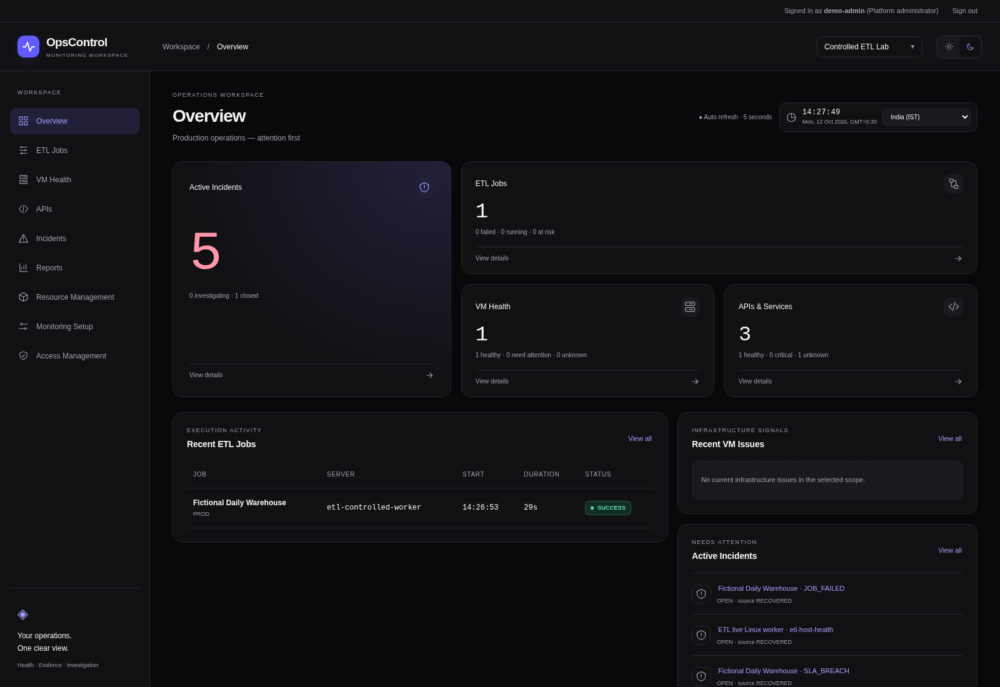
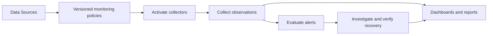
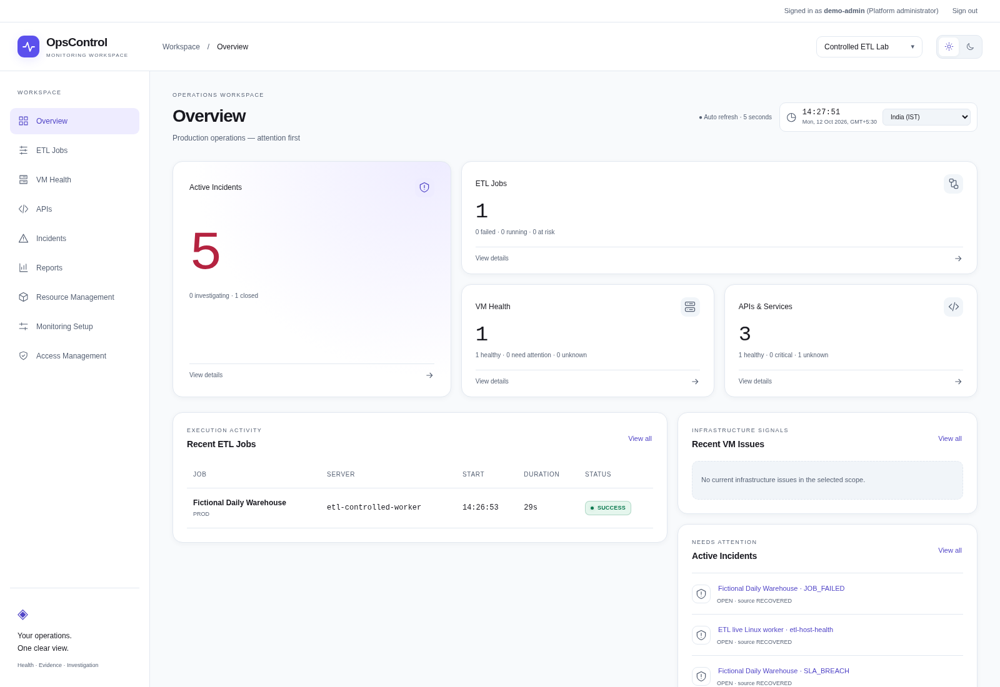
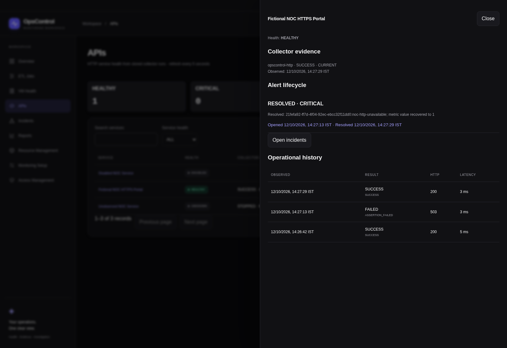

# OpsControl

**Your operations. One clear view.**

OpsControl brings application health, infrastructure signals, and Pentaho ETL operations into one monitoring workspace. It helps SREs, DevOps engineers, system administrators, and NOC teams answer three questions: **What needs attention? What evidence explains it? Has it recovered?**

[Quickstart](docs/QUICKSTART.md) · [User manual](docs/enterprise/02-user-manual.md) · [Architecture](docs/OPERATIONAL_ARCHITECTURE.md) · [Roadmap](docs/IMPLEMENTATION_ROADMAP.md)

[](https://github.com/Parikshit-Sahrawat/OpsControl_Dashboard/actions/workflows/validation.yml)



*Actual browser capture from the controlled monitoring lab. The examples use fictional services, synthetic HTTPS/ETL scenarios, and local Linux telemetry.*

## One connected monitoring lifecycle

A **Data Source** identifies what you monitor. **Versioned rules and templates** define what to collect and when to alert. **Activation** assigns supported collectors. Their observations become stored evidence for dashboards, alerts, investigations, and reports.



Registration is configuration; collection produces evidence. Missing or stale observations stay unknown. A worker heartbeat indicates collector liveness, while a target measurement establishes service health.

## What you can do

| Capability | Operational value |
|---|---|
| **Unified dashboards** | View health, active conditions, and operational history through clickable KPIs, organization filters, resource drill-downs, and persistent dark/light themes. |
| **HTTPS monitoring** | Collect approved endpoint availability and response timing, including supported Basic-auth secret references, and follow failure → alert → recovery evidence. |
| **Infrastructure monitoring** | Inspect CPU, memory, disk, and process observations; use AWS/Kubernetes adapters and read-only EKS discovery with explicit collection and deployment scope. |
| **Pentaho ETL monitoring** | Investigate No Run, Long Running, runtime SLA breaches, execution timelines, available step failures/logs, and host-health correlation through read-only Carte monitoring. |
| **Alert and incident lifecycle** | Apply consecutive-breach rules, deduplicate continuing conditions, record recovery, and manage operator investigations separately from target health. |
| **Operational reports** | Review sampled HTTP success, observed latency, ETL runtime SLA, and bounded history; export authorized report data as JSON. |
| **Organization-scoped access** | Separate tenant data through backend authorization, role-based permissions, distinct human/worker credentials, and audit history. |

ServiceNow incident delivery has a controlled open/retry/resolve acceptance path. Genuine provider accounts, permissions, routing, and deployment behavior require their own acceptance before live use.

<details>
<summary><strong>Explore the light theme and alert investigation</strong></summary>





These are actual browser captures of controlled scenarios, not illustrative dashboard mockups.

</details>

## Run locally with Docker

**Requirements:** Git, a running Docker Engine/Desktop with Compose and BuildKit, Python 3, and Bash. On Windows, use WSL2. Keep ports **8000** and **5173** available; application dependencies run inside containers.

```bash
git clone https://github.com/Parikshit-Sahrawat/OpsControl_Dashboard.git
cd OpsControl_Dashboard
bash scripts/demo-up.sh
```

Open `http://127.0.0.1:5173`. Sign in as **demo-admin** using the generated password in `.demo-private/admin-password`. Keep that file private.

The demo builds the UI and API, starts PostgreSQL, applies migrations, and creates a fictional organization. UI/API ports bind to loopback; the database has no published host port. Monitoring workers and genuine external integrations are configured separately. Empty or unknown views are expected before collection.

```bash
# Check the stack.
docker compose -f docker-compose.demo.yml ps

# Stop while preserving the database and generated password.
bash scripts/demo-down.sh
```

For installation verification, host-based development, enterprise certificate trust, and troubleshooting, see the [complete quickstart](docs/QUICKSTART.md). To generate telemetry and alert-recovery evidence, use the [HTTP monitoring lab](docs/HTTP_GOLDEN_PATH.md) or [operational dashboard lab](docs/OPERATIONAL_DASHBOARDS.md).

## Built for evidence-based operations

OpsControl uses **React and Vite** for the interface, **FastAPI** for authenticated APIs, and **PostgreSQL with SQLAlchemy and Alembic** for configuration, observations, incidents, and history. Remote HTTPS agents operate through approved destination policies and leased jobs. Local adapters require an explicitly authorized runtime in the appropriate host or provider environment.

Rules and templates are versioned so a resource's active configuration can be inspected. Alerts retain their supporting observations. Recovery and investigation closure are separate actions, preserving the operational record. See the [architecture guide](docs/OPERATIONAL_ARCHITECTURE.md) for the complete flow and trust boundaries.

## Documentation

| Start here | Guide |
|---|---|
| Install and explore | [Quickstart](docs/QUICKSTART.md) · [User manual](docs/enterprise/02-user-manual.md) |
| Understand the product | [Feature overview](docs/enterprise/01-product-feature-overview.md) · [Operator training](docs/enterprise/03-user-training-guide.md) |
| Configure monitoring | [HTTPS agent](docs/REMOTE_AGENT_QUICKSTART.md) · [Infrastructure](docs/INFRASTRUCTURE_MONITORING.md) · [Pentaho ETL](docs/PENTAHO_ETL_MONITORING.md) · [EKS discovery](docs/EKS_DISCOVERY.md) |
| Operate and integrate | [Dashboards and reporting](docs/OPERATIONAL_DASHBOARDS.md) · [ServiceNow](docs/SERVICENOW_INTEGRATION.md) |
| Review security and deployment | [Authentication](docs/AUTHENTICATION.md) · [OWASP verification](docs/security/OWASP_API_2023_CHECKLIST.md) · [Deployment and UAT](docs/DEPLOYMENT_UAT.md) |
| Evaluate enterprise terms | [Documentation and legal templates](docs/enterprise/README.md) |
| Track implementation | [Roadmap](docs/IMPLEMENTATION_ROADMAP.md) · [Runtime acceptance evidence](docs/OPERATIONAL_RELEASE_SEQUENCE.md) |

## Release status

**Development preview.** The monitoring lifecycle, tenant-negative checks, browser journeys, and controlled restore/TLS tests have recorded acceptance evidence. Genuine AWS/EKS, native Windows, Carte, and external incident-provider acceptance remain deployment-specific gates. Independent production security review, production-scale resilience, approved historical deletion, and operator UAT remain pending.

The current baseline does not include unrestricted OTLP ingestion, a generic public telemetry SDK, a drag-and-drop dashboard builder, or a complete distributed-trace explorer. EKS discovery imports inventory without assigning workload health. Commercial SLA and compliance documents are customizable review templates; a proposed 99.9% commitment is not an achieved availability claim.

## Feedback and contributions

Use [GitHub Issues](https://github.com/Parikshit-Sahrawat/OpsControl_Dashboard/issues) for reproducible bugs and feature requests. Include the version, affected workflow, and sanitized evidence. Report suspected vulnerabilities through [GitHub's private security reporting channel](https://github.com/Parikshit-Sahrawat/OpsControl_Dashboard/security) where enabled; keep credentials and sensitive customer data out of public issues.

For changes, follow the existing architecture and conventions, use a feature branch, run the checks relevant to the change, and describe the resulting behavior and validation in the pull request. Historical design and development notes are preserved in the [README archive](docs/archive/product-readme-history.md).

## Customer ownership and internal access


Resource Management manages external **Customers** and their monitored resources. Access Management manages the operating provider’s independent **Employees**, **Departments**, **Roles & Permissions**, **Customer Access** and **Access Audit**. Department membership never changes resource ownership, and customer selection never grants permissions. Access administrators do not automatically receive operational access.

The global customer selector applies to operational screens only; Resource Management and Access Management use independent filters. Migration `0025_provider_department_rbac` preserves existing customer/resource UUIDs, user accounts, password hashes and sessions while introducing explicit, backend-enforced role/customer grants. See [authentication and administration](docs/AUTHENTICATION.md), the [architecture and safe rollback contract](docs/architecture/CUSTOMER_DEPARTMENT_RBAC.md), and [test results, browser captures and exact Docker verification](docs/architecture/ACCESS_IMPLEMENTATION_REPORT.md).

The [full PostgreSQL schema/model reconciliation](docs/architecture/SCHEMA_MODEL_RECONCILIATION.md) eliminates all 32 previously reported drift groups without database changes. Automated acceptance requires a clean `alembic check`; single-provider operation is supported, with independent security review and UAT performed locally by the owner.

