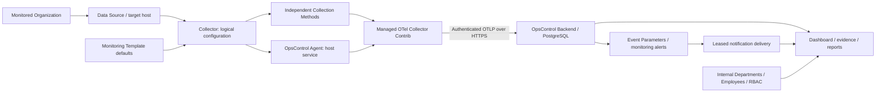

# OpsControl Dashboard

**Your operations. One clear view.**

OpsControl is a monitoring control plane for infrastructure, APIs and data pipelines. It connects organization-owned resources, real telemetry, versioned collection configuration, monitoring alerts and independently tracked notifications. Missing or stale evidence stays unknown.

[Docker quickstart](docs/QUICKSTART.md) · [Managed agent installation](agent/README.md) · [UAT implementation and verification](docs/CONSOLIDATED_UAT.md) · [Access architecture](docs/architecture/CUSTOMER_DEPARTMENT_RBAC.md)

## Architecture



A **Collector** is a logical configuration entity, not an executable. One host Collector binds one **OpsControl Agent**, installed as a Linux systemd or Windows Service. The agent supervises the upstream **OpenTelemetry Collector Contrib** runtime. A Collector can contain multiple independently identified methods, including repeated methods of the same type. The backend also preserves existing approved HTTP, infrastructure and read-only Pentaho monitoring adapters.

Resource Management **Organizations** are monitored customers and retain their existing resource ownership. Access Management **Departments** are internal service-provider teams. New employee onboarding follows Department → Employee → Permissions and requires one existing department. Backend RBAC and organization grants enforce access on every request; selecting an organization does not grant access. Administrative pages use independent filters.

## Supported collection methods

| Method | Configuration and signals |
|---|---|
| **File Log** | Absolute file paths, exclusions, text/JSON parsing and multiline starts. Linux Journald and Windows Event Log are OS-specific log source options. |
| **Metric Scrape** | Prometheus-compatible targets, collection interval, TLS and protected authentication references. |
| **OTLP Receiver** | Loopback HTTP or gRPC listener; explicitly select Logs, Metrics and/or Traces. Remote listeners require explicit approval, TLS and authentication. |
| **Native OS Metrics** | OTel hostmetrics supplies host CPU, memory, disk, filesystem and process metrics. This is a native telemetry source, not a fourth top-level method. |

Data Sources supply the host OS. Linux and Windows are supported deployment targets; existing Other OS records remain valid inventory and are unsupported for host-agent installation. Saving a log path does not grant file permissions. The installed service must have real access to the configured source.

Configuration revisions provide YAML preview/download, actual pinned-runtime validation, approval history and rollback metadata. **Saved**, **validated**, **approved/applied**, **connected** and **receiving** are distinct states. Agent heartbeat is separate from per-signal receipt timestamps/counts. A host IP does not provide a remote installation channel.

## Alerts and notifications

Event Parameters reuse the monitoring alert engine. Percentage metrics support static, dynamic-baseline and combined thresholds, minimum sample counts, full consecutive observation windows and missing-data gap checks. For example, CPU above 80% over five minutes requires evidence spanning that condition; a single sample cannot open the alert. Continuing breaches are deduplicated, and recovery is driven by telemetry.

Notification Delivery provides organization-scoped in-app, SMTP and HTTPS webhook destinations, secret references, leased retries/backoff, stable delivery identifiers, destination throttling, grouping metadata and measurable queue lag. Alert acknowledgment can suppress configured escalation. External recipients must be provisioned and network destinations allowlisted by an operator. SMS/voice, Slack, Teams and mobile push remain unavailable until supported adapters and infrastructure are configured.

**Incident Management and ServiceNow are retired.** Monitoring alerts, correlation, pipeline investigations, alert history and notifications remain independent. Historical incident tables/records are retained; no destructive removal migration is applied.

## Run locally

Requires Docker Engine/Desktop with Compose and BuildKit, Git, Python 3 and Bash (WSL2 on Windows).

```bash
git clone https://github.com/Parikshit-Sahrawat/OpsControl_Dashboard.git
cd OpsControl_Dashboard
bash scripts/demo-up.sh
```

Open `http://127.0.0.1:5173`. Sign in as `demo-admin` using the generated private `.demo-private/admin-password` file. The demo applies additive migrations and seeds neutral fictional examples. Stop with `bash scripts/demo-down.sh`; its database is preserved.

The local HTTP UI/API demo is for exploration. Real host-agent export requires an approved **HTTPS backend origin**, valid trust, an actual compatible validation binary and an enrolled agent. Configure `OPSCONTROL_PUBLIC_INGESTION_URL`, `OPSCONTROL_OTEL_BINARY` and, for authenticated package downloads, `OPSCONTROL_AGENT_PACKAGE_DIR`. Unavailable packages or validation infrastructure produce errors or UNVALIDATED states, never successful deployment claims.

See [agent packaging and platform installation](agent/README.md) and [exact Docker/TLS/OTel validation commands](docs/CONSOLIDATED_UAT.md). No live cloud credentials are needed for controlled acceptance.

## Telemetry flow

Generated configuration sends enabled receiver signals to authenticated OpsControl OTLP/HTTP endpoints:

```yaml
exporters:
  otlphttp/opscontrol:
    endpoint: https://opscontrol.example.test/api/v1/agent/otlp
    headers:
      Authorization: Bearer ${env:OPSCONTROL_AGENT_TOKEN}
    tls:
      insecure: false
```

The endpoint above is a documentation example; generation requires your actual configured backend origin. Credentials stay in protected target state/environment and are never embedded in stored configuration. The backend authenticates each agent, derives organization/Collector ownership server-side, bounds/decompresses input and persists actual Logs, Metrics and Traces. Retried identical batches are deduplicated. Distribution-specific receivers and target permissions are validated independently.

## Interface and validation

The UI provides compact organization/resource/collector/method tables, Data Pipelines, monitoring Alerts, Event Parameters, Notification Delivery, independent Access Management and a collapsible accessible sidebar in both themes. Wide tables scroll within their containers; long identifiers wrap.


Actual controlled-runtime Playwright captures and redacted evidence are linked in the [UAT report](docs/CONSOLIDATED_UAT.md). No illustrative image is presented as runtime evidence.

## Release status

This is a **development preview**, with a single-provider runtime accepted by the owner. Independent security review and operator UAT are conducted locally by the owner. Production deployment remains a separate explicit approval; no production records are modified by development acceptance.

Native Windows service/runtime acceptance, genuine AWS/Carte acceptance and deployment-scale testing require their respective environments. There is no remote host installation, public unauthenticated ingestion, complete trace explorer or additional notification-provider implementation. The unspecified third Resource Management tab remains an outstanding product decision. Historical populated-schema rollback is guarded; retain the additive schema and follow the documented backup/recovery plan.

Report reproducible issues through [GitHub Issues](https://github.com/Parikshit-Sahrawat/OpsControl_Dashboard/issues), with version and sanitized evidence. Keep credentials and sensitive customer telemetry out of public reports.
