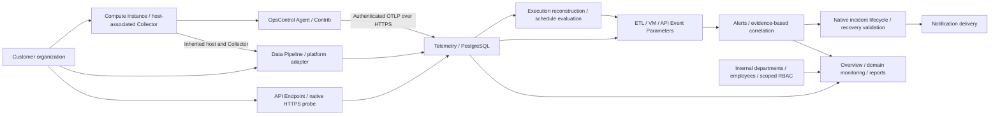
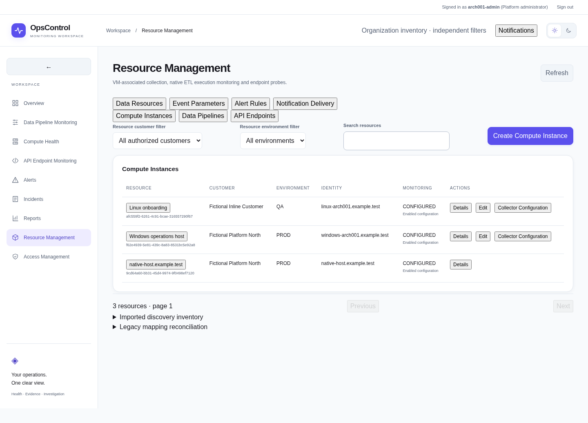

# OpsControl Dashboard

**Your operations. One clear view.**

OpsControl is a monitoring control plane for infrastructure, APIs and data pipelines. It connects organization-owned resources, real telemetry, versioned collection configuration, monitoring alerts, native incidents and independently tracked notifications. Missing or stale evidence stays unknown.

[Unified architecture and operations](docs/ARCH_001_OPERATIONS.md) · [Docker quickstart](docs/QUICKSTART.md) · [Managed agent installation](agent/README.md) · [UAT implementation and verification](docs/CONSOLIDATED_UAT.md) · [Access architecture](docs/architecture/CUSTOMER_DEPARTMENT_RBAC.md)

## Architecture



A **Collector** is a logical configuration entity, not an executable. One host Collector binds one **OpsControl Agent**, installed as a Linux systemd or Windows Service. The agent supervises the upstream **OpenTelemetry Collector Contrib** runtime. A Collector can contain multiple independently identified methods, including repeated methods of the same type. The backend also preserves existing approved HTTP, infrastructure and read-only Pentaho monitoring adapters.

Resource Management contains **Data Resources** (Compute Instances, Data Pipelines and API Endpoints), **Event Parameters**, **Alert Rules** and **Notification Delivery**. Organizations are created inline during resource onboarding and remain normalized customer ownership boundaries. Internal Departments and employees remain separate in Access Management. Customer-scoped backend authorization applies to every request; the global selector grants no access and does not filter administrative pages.

The Compute Instance wizard supports ten clickable stages, draft save/resume, Linux/Windows, Private Cloud/Public Instances, telemetry configuration, Agent installation and enrollment, verification, collection, optional parameters/rules/delivery, validation and activation. Activation requires backend evidence; skipping optional alerting configuration does not prevent monitoring. Editing uses version checks and explicit configuration approval.

A versioned backend Attribute and Capability Registry drives forms and server-side validation. Effective parameter previews show inherited and overridden values. Existing execution history, identities and customer relationships survive additive migrations.

## Supported collection methods

| Method | Configuration and evidence |
|---|---|
| **Host Metrics** | Actual CPU, memory, disk, filesystem and network from Contrib hostmetrics. |
| **Services** | Windows Service, Linux systemd and configurable process observations from the Agent. |
| **Syslog** | Independent TCP/UDP source, safe binding defaults and explicit secure remote-listener approval. |
| **File Logs** | Multiple paths, exclusions, multiline parsing and durable rotation/restart checkpoints. Journald/Event Log are OS-specific source options. Quiet readable sources remain Idle. |
| **OpsControl Scrape** | Actual Prometheus/OpenMetrics requests, timeout, TLS, secret references, labels and filters. |
| **OTLP transport** | Advanced HTTP/gRPC reception with explicit Logs/Metrics/Traces signals; only selected signals enter pipelines. |

Data Sources supply the host OS. Linux and Windows are supported deployment targets; existing Other OS records remain valid inventory and are unsupported for host-agent installation. Saving a log path does not grant file permissions. The installed service must have real access to the configured source.

Configuration revisions provide YAML preview/download, actual pinned-runtime validation, approval history and rollback metadata. **Desired**, **downloaded**, **applied**, **verified**, **connected** and **receiving** are distinct states. Agent heartbeat is separate from per-signal receipt timestamps/counts. A host IP does not provide a remote installation channel.

## Alerts and notifications

Event Parameters reuse the monitoring alert engine. Percentage metrics support static, dynamic-baseline and combined thresholds, minimum sample counts, full consecutive observation windows and missing-data gap checks. For example, CPU above 80% over five minutes requires evidence spanning that condition; a single sample cannot open the alert. Continuing breaches are deduplicated, and recovery is driven by telemetry.

Notification Delivery provides organization-scoped in-app, user/team targeting and personal opt-out preferences, SMTP and HTTPS webhook destinations, secret references, leased retries/backoff, stable delivery identifiers, destination throttling, grouping metadata and measurable queue lag. Alert acknowledgment can suppress configured escalation. External recipients must be provisioned and network destinations allowlisted by an operator. SMS/voice, Slack, Teams and mobile push remain unavailable until supported adapters and infrastructure are configured.

Native incidents follow **Open → Acknowledged → Investigating → Recovery in Progress → Monitoring → Resolved → Closed**, with assignment, notes, evidence, escalation, reopening and an audit timeline. Recovery requires fresh actual evidence and a stable observation window. Correlation describes supported associations, not proven causation. ServiceNow, PagerDuty and external ticket synchronization are outside scope.

## Data Pipeline integrations

Native read-only adapters cover **Pentaho PDI, Informatica IICS, Apache Airflow, Apache NiFi, Azure Data Factory, AWS Glue, SSIS, Talend and Custom/Shell**. Configure a platform's backend-provided fields and managed credential references. Adapters retain native execution/flow semantics, checkpoints, source evidence and classified errors. SaaS pipelines need no artificial VM relationship; host pipelines inherit their Compute Instance and Collector.

Execution reconstruction preserves raw records, logical execution identity, step attempts, parallelism, out-of-order evidence and conflicting statuses. The independent schedule engine persists expected windows for No Run and Delayed evaluation even when no logs arrive. Unknown timestamps and unavailable telemetry remain unknown.

[Integration contracts and live-validation limitations](docs/integrations/PIPELINE_ADAPTERS.md) · [Implementation status and evidence](ARCH-001_IMPLEMENTATION_STATUS.md)

## Resource workspace



This capture comes from authenticated Playwright against an owned PostgreSQL/FastAPI test environment with explicitly fictional resources. It shows configured inventory, not a claim of live host acceptance.

## Run locally

Requires Docker Engine/Desktop with Compose and BuildKit, Git, Python 3 and Bash (WSL2 on Windows).

```bash
git clone https://github.com/Parikshit-Sahrawat/OpsControl_Dashboard.git
cd OpsControl_Dashboard
bash scripts/demo-up.sh
bash scripts/build-demo-agent.sh  # Linux host; approved pinned runtime package
```

Open `http://127.0.0.1:5173`. Sign in as `demo-admin` using the generated private `.demo-private/admin-password` file. The demo applies additive migrations and seeds neutral fictional examples. The API, frontend, PostgreSQL, authenticated TLS ingestion gateway and native background worker run together. Stop with `bash scripts/demo-down.sh`; its database is preserved.

The local UI/API use loopback HTTP for development. The ingestion gateway exposes `https://localhost:8443` with a private local CA generated by `demo-up.sh`. Trust `.demo-private/gateway/ca.crt` explicitly on the test host and configure the Agent/Contrib trust store; never disable TLS verification. A remote target needs a reachable approved DNS identity and matching certificates rather than `localhost`.

Configure `OPSCONTROL_PUBLIC_INGESTION_URL`, the compatible `OPSCONTROL_OTEL_BINARY`, and `OPSCONTROL_AGENT_PACKAGE_DIR` for authenticated package downloads. Missing packages or validation infrastructure return errors or Unvalidated states. The Windows service/installer build pipeline and Linux installer source are included; native host installation evidence is recorded separately from source/build checks.

See [agent packaging and platform installation](agent/README.md) and [exact Docker/TLS/OTel validation commands](docs/CONSOLIDATED_UAT.md). No live cloud credentials are needed for controlled acceptance.

## Telemetry flow

Generated configuration sends enabled receiver signals to authenticated OpsControl OTLP/HTTP endpoints:

```yaml
exporters:
  otlphttp/opscontrol:
    endpoint: https://opscontrol.example.test/api/v1/agent/otlp
    headers:
      Authorization: Bearer ${env:OPSCONTROL_AGENT_TOKEN}
    tls:
      insecure: false
```

The endpoint above is a documentation example; generation requires your actual configured backend origin. Credentials stay in protected target state/environment and are never embedded in stored configuration. The backend authenticates each agent, derives organization/Collector ownership server-side, bounds/decompresses input and persists actual Logs, Metrics and Traces. Retried identical batches are deduplicated. Distribution-specific receivers and target permissions are validated independently.

## Interface and validation

Official operational pages are Overview, Data Pipeline Monitoring, Compute Health, API Endpoint Monitoring, Incidents and Reports. Reports use persisted data for all three domains. KPI counters open filtered lists. Tables, resource details, responsive forms, loading/error/empty states, collapsible navigation and both themes share the existing design system.

```bash
make test-unit
make test-agent
make test-integration
make test-e2e
make test-security
make test-docker
make test-all
```

Prepare the dependencies documented in [Testing V1.5](docs/TESTING_V15.md). Integration/browser labs use disposable PostgreSQL and fictional resources. The runtime lab executes the pinned Contrib binary and actual TLS telemetry. CI runs on pushes to `main`; logs, coverage, screenshots and redacted results are retained as artifacts. Failed, skipped, controlled-fixture and live-provider results are distinguished in the [implementation matrix](ARCH-001_IMPLEMENTATION_STATUS.md).

## Release status

This is a **development preview**, with a single-provider runtime accepted by the owner. Independent security review and operator UAT are conducted locally by the owner. Production deployment remains a separate explicit approval; no production records are modified by development acceptance.

Native Windows service/runtime acceptance, genuine AWS/Carte acceptance and deployment-scale testing require their respective environments. Remote host installation requires an approved SSH/WinRM channel and is not claimed by knowing a host IP. Public unauthenticated ingestion and a complete trace explorer are not provided. Historical populated-schema rollback is guarded; retain the additive schema and follow the documented backup/recovery plan.

Report reproducible issues through [GitHub Issues](https://github.com/Parikshit-Sahrawat/OpsControl_Dashboard/issues), with version and sanitized evidence. Keep credentials and sensitive customer telemetry out of public reports.
