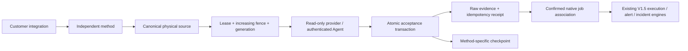
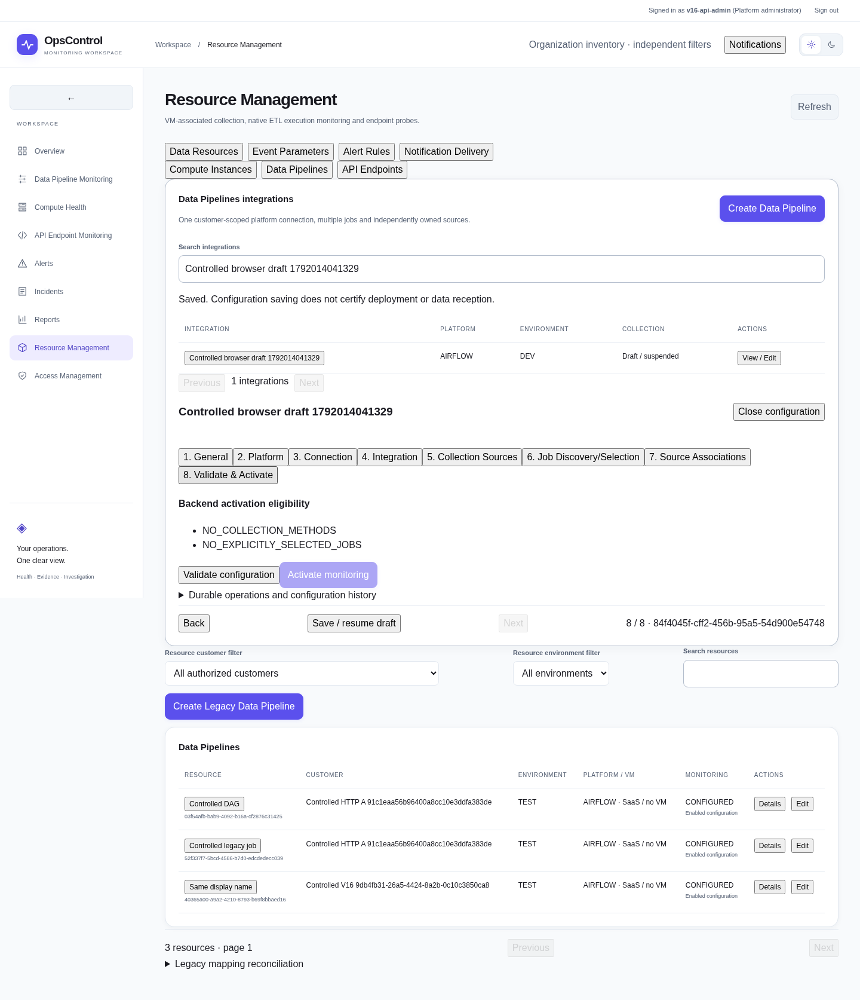
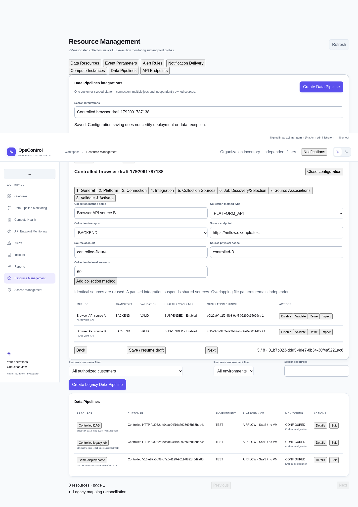
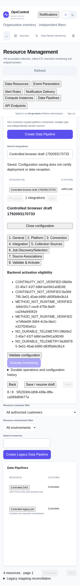

# ARCH-001 V1.6 — Data Pipelines

## Scope and compatibility

V1.6 adds customer-scoped integrations inside **Resource Management → Data Resources → Data Pipelines**. The existing legacy onboarding path remains available. Compute onboarding, VM Agent installation, Event Parameters, Alert Rules, Notifications, schedules, SLA, execution reducers, correlation and native incident transitions retain their V1.5 contracts.

One integration is a platform account/endpoint/environment boundary, with immutable connection versions, capability profiles, independent collection methods and explicit native job selection. The wizard has exactly eight stages: General; Platform; Connection; Integration; Collection Sources; Job Discovery/Selection; Source Associations; Validate & Activate. Draft fields survive closing, refreshing and resuming the wizard. Saving a configuration does not activate monitoring.

Internal departments remain separate from monitored customer organizations. Every new API applies customer scope and backend permissions; a human login cannot use the Agent transport endpoints.

## ARCH-ETL-001 V1.6 reconciliation

The [immutable owner-approved Pentaho baseline](architecture/ARCH_ETL_001_V16.md)
controls Pentaho behavior. It was published byte-for-byte in `ce603a4` from the
owner's R1 README at `cab0e63`; it is a consolidated approved reconstruction,
not a verbatim archival transcript. Existing V1.5 compatibility statements do
not waive its Pentaho-specific requirements. The other eight platforms retain
their contracts and need regression coverage for shared changes.

The [Sprint 01 reconciliation](architecture/ARCH_ETL_001_V16_R1_RECONCILIATION.md)
maps REC-01–REC-12 to clauses, canonical owners, concrete gaps and later slices.
The existing resource/history/reducer, evidence/fences/holds, outbox, incidents
and RBAC remain the shared foundation. Logical-run attempts, last-verified
conflict-safe revisions and historical-failure idempotency require extensions;
their runtime behavior is not implemented by this documentation update.

The catalogue now distinguishes proposed Kitchen/Pan and Server surfaces from
partial legacy Carte job-status support. Every static surface is runtime-unverified;
10.2.x/11.0.x are candidates only. This metadata changes no runnable adapter,
connection schema or activation/verification gate. New employees require exactly
one department; legacy multiple memberships and direct roles are preserved under
the approved resolution. The RT-001–RT-020 reconstruction is the approved R1
working coverage index; original wording is not required to proceed.

## Implementation matrix

| Area | Status and evidence |
|---|---|
| Eight-step drafts, connections, explicit jobs and source associations | Implemented; real HTTP and desktop/mobile browser checks passed. |
| Fencing, atomic evidence/checkpoints, shared holds and reviewed legacy handoff | Implemented; PostgreSQL race/durability and HTTP transition checks passed. |
| Additive migration and V1.5 compatibility | Populated upgrade, schema drift and downgrade guards verified; protected regressions passed. |
| Platform collection adapters and file transport | Implemented with deterministic tests; genuine nine-platform and native-host acceptance pending. |
| Provider continuity, bounded recovery and installed-version detection | Partial: backend anchor proofs and some provider replay are unavailable; redetection supplies documented capabilities only. Affected paths fail closed. |
| Production activation and post-merge verification | Not performed; this is a reviewable development implementation, not production acceptance. |

## Data and migration mapping

Additive revision **0032_pipeline_ownership**, following **0031_in_app_notifications**, creates ten tables:

| Table | Responsibility |
|---|---|
| pipeline_integrations | Platform/customer/environment boundary, draft stage, enabled state |
| pipeline_connections | Immutable configuration versions, checksum, active version |
| pipeline_capabilities | Installed-version declaration, compatibility and evidence status |
| pipeline_sources | Canonical physical unit, generation, lease, fence, separate cursors |
| pipeline_methods | Integration-to-source reader configuration and health/eligibility |
| pipeline_jobs | Stable native identity, selection, quarantine and stale status |
| pipeline_associations | Operator-confirmed job/method association bound to source generation |
| pipeline_holds | Composed integration, manual, continuity and legal holds |
| pipeline_evidence | Durable raw evidence identity, payload and acceptance outcome |
| pipeline_operations | Idempotent operations, independent review, recovery and audit metadata |

Composite foreign keys reject cross-customer references. Existing organizations, users, departments, resources, executions and historical evidence are retained. No existing customer UUID is reused as an employee department identity.

Selected jobs project onto existing `MonitoringResource`/`JobOrder` identities through a non-executing `PIPELINE_V16_PROXY` Collector. Only evidence matched to a confirmed native job reaches the existing reconstruction path. Display names never establish identity. Unmatched or conflicting evidence is quarantined. Existing `HOSTED_ON` relationships are retained; sharing a source never creates execution dependencies.

The reviewed legacy handoff acquires the same legacy Collector advisory lock, requires one explicitly confirmed resource association, preserves the original Collector UUID/configuration/history/runtime checkpoint, archives its checkpoint and retires its independent polling by changing it to the proxy type. It does not silently associate arbitrary legacy resources. Legacy bindings start quarantined (`LEGACY_PENDING`) and cannot be selected before the independent handoff confirms the exact native ID/platform/environment. Resource activation and monitoring are paused until explicit selection, current-generation associations and genuine eligibility are restored. Source rollback does not automatically restart the independent legacy poller; reversing a complete legacy migration requires its documented backup/reverse-transition procedure.

## Fenced collection and suspension



Claims and commits lock the source row. Every commit checks the current owner, live lease, fence, source generation, suspension and capability eligibility. Raw evidence, idempotency receipt, V1.5 projection and checkpoint update share one PostgreSQL transaction. A delayed owner with fence 41 cannot commit after fence 42 succeeds. Source changes invalidate previous-generation associations and runtime proofs.

Pausing an integration creates durable holds on all referenced sources, including shared sources. Manual holds compose with integration holds. Legal holds protect retention; they are released only by an independent administrator. Collection and failover are denied while collection holds remain. Clearing one hold does not bypass other holds or checkpoint continuity validation.

Source changes use impact preview, independent administrator approval, a revision/generation check, fenced handoff and a checkpoint archive. Rollback preview creates another reviewed generation transition, restores the archived identity, cursor and method/connection/capability references, and requires continuity validation. Changed method membership rejects the old rollback plan. Restoring configuration never silently restores runtime eligibility. Changing native account/physical authority requires a new integration/job identity. Shared connection replacement must satisfy each affected integration's ownership; unsupported remapping is rejected.

## Collection, discovery and recovery

Read-only V1.5 adapters are reused for Pentaho PDI, IICS, Airflow, NiFi, Azure Data Factory, AWS Glue, SSIS, Talend and Custom/Shell. Glue uses its region-derived endpoint, 12-digit account and `region:<region>` source scope; the worker checks STS caller identity and job ARN authority before collection. Provision `opsc-pipeline-<customer-uuid-without-hyphens>-<name>` AWS profiles for that customer; default backend credentials and another customer's profiles cannot be delegated. New collection transports are platform API, structured File Log and supported database collection. Unsupported platform/method combinations remain ineligible.

Platform APIs use customer-bound managed secret references and existing approved egress validation. Provision variables named `OPSCONTROL_PIPELINE_SECRET_<CUSTOMER_UUID_WITHOUT_HYPHENS_UPPERCASE>_<NAME>` in the backend environment and use `env:` references to them. Other customer namespaces and application/Agent credential variables are rejected. Existing V1.5 references are unaffected. Do not commit secret values. Airflow/IICS/Glue retain independent native-job cursors and bounded round-robin polling. Azure identities are factory-qualified ARM pipeline IDs. SSIS uses project ID plus package GUID and deployment-version joins, avoiding attribution of old package deployments to a new identity. SSIS selected-job queries are explicitly bounded to 100 jobs; larger selections fail with a visible limit rather than omit jobs silently.

Global discovery cadence is 24 hours and redetection is seven days, with on-demand operations. Discovery never selects jobs automatically. Only complete authorized inventories can mark absent jobs stale. Renames retain native job UUIDs. Ambiguous/manual-discovered matches require operator confirmation. Pentaho Carte running-status inventories and Custom/Shell do not constitute an authoritative persistent catalogue; these use manual native identity registration rather than unsafe absence reconciliation. Static adapter capability descriptions remain documented evidence, not runtime verification.

The optional structured-log client is served by `/api/v1/data-pipelines/agent-client` and lives in `backend/app/data_pipelines/transport.py`. It uses an existing resource-bound Agent identity and verified HTTPS, claims before reading, supports independent file paths, retains partial lines, bounds reads, and advances only backend-owned cursors after acknowledgement. Distinct byte offsets remain distinct even when messages and timestamps match. Rotation/truncation stop collection until an evidence-based continuity/recovery or reviewed generation transition is provided. Existing VM file receivers must relinquish the exact source before this transport may claim it.

Example (keep the existing identity file private; do not copy its contents into forms):

```sh
python transport.py --backend https://opscontrol.example.test \
  --identity-file /var/lib/opscontrol-agent/identity.json \
  --ca-file /etc/opscontrol-agent/ca.pem --source-id SOURCE_UUID
```

Recovery uses a different cursor and durable range operation. Live collection has priority. Automatic bounds are six hours for File Log and 24 hours for platform/database sources, including maximum lookback. Beyond-bound recovery requires independent approval. Current executable bounded replay covers structured files and the supported ADF/NiFi request ranges. Other backend providers stop with `BOUNDED_PROVIDER_REPLAY_NOT_SUPPORTED`; they are not retried indefinitely or represented as recovered. Backend post-handoff continuity without a provider-supported anchor proof is explicitly blocked. These are remaining implementation limitations, separate from deferred live acceptance.

File continuity challenges are short-lived, generation/cursor-bound and require authenticated filesystem observations matching saved inode/device/offset. Readable paths in the UI alone do not establish filesystem permission or continuity. Backend sources do not gain continuity from an HTTP connection check.

## Activation and runtime acceptance

All newly declared profiles default to unverified. Pentaho version catalogue entries are candidates; the installed version remains unknown. A connection test, fixture, documentation or unit test never enables a method. Activation requires genuine accepted native evidence, a matching reader-definition hash/source generation, independently attested runtime capability, current confirmed associations, continuity and the existing V1.5 resource readiness checks.

Genuine runtime verification is disabled by default. Its separately approved workflow requires `OPSCONTROL_PIPELINE_RUNTIME_ACCEPTANCE=1`, an independently approved verification operation and an actual installed version. This implementation did not enable that switch or contact a live vendor. Source edits invalidate eligibility until the new reader is verified.

## Retention

Daily cleanup removes eligible raw evidence after 30 days, unprotected inactive cursors after 14 days, unselected unreferenced stale jobs seven days after qualifying discovery, and gap metadata after 30 days. Selected stale jobs are protected indefinitely. Legal holds protect associated retained data and require independent release. Configuration retirement is soft and never cascades into raw evidence or execution history. V1.5 projections contain normalized events and evidence references, keeping duplicate raw provider payloads out of longer-lived histories. Runtime attestation metadata survives raw-payload retirement without retaining the raw provider payload. Audit records are not pruned by this cleanup, preserving at least the 365-day requirement. Cleanup batches are bounded; high-volume operators must measure backlog before deployment.

## APIs

The `/api/v1/data-pipelines` router exposes integration CRUD/drafts, immutable connection versions, capability profiles, methods and validation, paginated jobs, explicit selection/manual discovery reconciliation, generation-bound associations, activation/suspension, source impact and holds, recovery plans, reviewed source changes/rollback previews, operation status and paginated evidence. Mutation DTOs reject extra fields and plaintext credential keys. Repeated operation keys with different target/payload are rejected. Optimistic revisions protect edits.

The machine-only `/api/v1/agent/pipeline-claim`, `/pipeline-evidence` and `/pipeline-continuity` routes reuse authenticated Agent identity, revocation, host and customer binding. They cannot be called with a human bearer token.

## Verification and local commands

```sh
# Existing dependencies; Docker is required for the owned PostgreSQL lab.
make test-pipeline-v16
V16_API_ACCEPTANCE=1 V16_BROWSER_ACCEPTANCE=1 \
  backend/.venv/bin/python scripts/v16-acceptance.py
# Set PLAYWRIGHT_MODULE / PLAYWRIGHT_CHROMIUM_EXECUTABLE for your installation.
npm run lint --prefix frontend
npm test --prefix frontend
npm run build --prefix frontend
make test-docker
```

The owned lab creates and removes only its randomized PostgreSQL container. It upgrades a populated V1.5 customer, checks zero model/schema drift, tests empty downgrade/re-upgrade and rejects populated downgrade before any table removal. Save a database backup before upgrading any persistent local demo:

```sh
mkdir -p .demo-private/backups
docker compose -f docker-compose.demo.yml exec -T postgres \
  pg_dump -U opscontrol -d opscontrol -Fc > .demo-private/backups/pre-v16.dump
docker compose -f docker-compose.demo.yml exec -T postgres \
  pg_restore --list < .demo-private/backups/pre-v16.dump >/dev/null
docker compose -f docker-compose.demo.yml up --build -d
```

Restore into an isolated database first and compare record counts before using a backup for rollback. Populated V1.6 downgrade intentionally refuses; preserve/export V1.6 records or restore a verified pre-upgrade backup with the matching V1.5 image. Never discard new evidence merely to downgrade schema.

Actual verification artifacts are in [verification/arch001-v16](verification/arch001-v16). They distinguish hypothetical preverified ownership fixtures from live vendor acceptance. Local results: 20 actual PostgreSQL tests; 107 focused backend tests (including thirteen file/native identity/security tests); six frontend authorization tests; nine real HTTP acceptance groups; actual desktop/mobile Playwright wizard and draft-resume checks; frontend lint/build; additive migration checks. No production or vendor environment was accessed. Docker frontend/backend/worker images built successfully. The isolated five-service Compose stack passed startup, migrations, restart/session persistence, authentication and frontend security-header checks after recovering unused Docker build-cache capacity. The existing V1.5 demo was preserved. The Docker run preceded the final legacy-handoff and retention fixes; the final source was subsequently exercised by the PostgreSQL, HTTP and browser lab. An exact-head Docker rebuild remains a CI/reviewer check.



## Platform compatibility and runtime limitations

The matrix describes the **current code**, not a certification of vendor support. All nine platforms have **zero verified live runtime capabilities in this PR**. `DOCUMENTED` means an adapter/schema describes a capability; deterministic transport fixtures, fake SDKs and local files establish local contract behavior only. The expanded browser discovery uses explicitly sample-labelled inventory through the real worker/database. It does not contact Airflow or produce runtime eligibility proof. Newly declared capabilities remain unverified and activation stays blocked.

| Platform | Documented / implemented capability | Locally tested capability | Live runtime | Version and authentication dependencies | Unknown or unsupported capability |
|---|---|---|---|---|---|
| Pentaho PDI | Read-only Carte XML job status, step evidence and optional logs; structured-log/manual native identity onboarding | Carte response parsing, step failure evidence without invented timing; shared JSONL transport tests | None; unverified | Installed version **unknown**. 8.3/9.3/9.4 are catalogue candidates only. Actual Carte URL, execution ID, credential reference and approved host/CIDR required | Authoritative persistent job discovery is unsupported through running Carte status. API/version compatibility and native stable job IDs must be validated; no arbitrary local scheduler/DB schema adapter is inferred |
| Informatica IICS | Task catalogue and activity-log reads; explicit task IDs and embedded activity details | Normalization, warning/unknown states, offsets, activity/step schema failures | None; unverified | Tenant edition/region and documented API routes must match. Managed session credential reference; header supports INFA-SESSION-ID/icSessionId/Authorization as configured | Token/session renewal is externally managed. Edition-specific pagination, detail completeness and authority are unverified; backend historical replay unsupported |
| Apache Airflow | DAG inventory, DAG runs and bounded optional task-instance reads | Paging, run/task attempts, bounded step continuation; actual UI/worker discovery with **fixture inventory** | None; unverified | Stable DAG IDs, least-privilege REST credentials. Discovery currently targets `/api/v1`; installed major/API version must be confirmed | Airflow 3/API v2 inventory is not implemented by the v1 discovery path. Server restart/token expiry and large-inventory latency are unverified; backend historical replay unsupported |
| Apache NiFi | Process-group/processor inventory and asynchronous read-only provenance searches; flow/process semantics retained | Async query continuation, flow normalization and schema failures | None; unverified | Process-group/component IDs, installed provenance API and permissions; managed HTTPS authentication | Provenance events are **not guaranteed jobchain executions**. Query retention/permissions vary; root cause and complete execution boundaries cannot be inferred. Recovery is limited to supported timestamp-bounded searches |
| Azure Data Factory | ARM factory-qualified pipeline identity, pipeline runs and activity details | Request time bounds, continuation, normalized states and qualified native authority | None; unverified | Subscription/resource group/factory, ARM API version and explicit initial `after`; managed bearer-token reference. Renewal external | Actual Azure RBAC, token renewal and API quotas unverified. Replay only within supported query windows and retained provider evidence; no provider anchor continuity proof |
| AWS Glue | Read-only job inventory/runs via SDK, native job ARN/account/region checks | Fake SDK pagination/statuses; STS account/partition/ARN mismatch rejection | None; unverified | Approved region/account, customer-bound workload profile, boto3, least-privilege Glue and STS reads | IAM/network/throttle behavior and continuation expiry remain unverified. No default backend credentials delegation; no generic backend bounded historical replay |
| SSIS | Read-only SSISDB package inventory/executions with project/package GUID and deployment-version join | Fake ODBC cursor, active-run revisits and execution normalization | None; unverified | **Native supported SQL Server ODBC driver + pyodbc**, SSISDB database context and SELECT permissions, protected connection reference. Driver is not bundled by this PR | Native driver installation, encrypted SQL connection policy, catalogue/version compatibility and linked-server setups unverified. Maximum 100 selected jobs per collection query; backend historical replay unsupported |
| Talend | Regional task inventory and execution-list reads using task/execution IDs | Normalization, failure/unknown handling and generic HTTP/auth/retry boundaries | None; unverified | Actual regional API release/routes, task identity, managed authentication reference | Vendor-specific inventory/pagination and task history completeness unverified. No automatic token renewal, historical replay or provider continuity anchors |
| Custom/Shell | Approved structured JSONL producer contract; read-only file transport, no shell execution | Real local files: distinct identical-content records, partial lines, failure ACK, truncation, checkpoint and rotation behavior | None on a target Agent host; unverified | Stable native job/execution IDs, approved absolute paths/read roots and filesystem rights. V1.6 file transport requires an existing authenticated resource-bound Agent | No arbitrary command execution or authoritative job discovery. V1.6 structured JSONL only; arbitrary proprietary text parsing and archive search are not implemented |

### Collection, checkpoints, recovery and continuity

| Platform | Collection / checkpoint behavior | Recovery and continuity limit |
|---|---|---|
| Pentaho PDI | Carte requires explicit supported execution identity; V1.6 accepted file sources keep device/inode/byte offsets and independent path state | Structured-file recovery only within bounded saved evidence; Carte backend replay and provider anchor continuity unsupported |
| IICS | One scoped selected task per source poll in bounded round-robin; per-task offset cursor | API offset drift/expiry needs real acceptance. Unsupported backend replay stops explicitly; no automatic continuity approval |
| Airflow | Per-DAG run cursor plus bounded optional step queue; one selected DAG per source poll | Backend historical replay unsupported. Task/run inventory and cursor continuity across API changes must be verified |
| NiFi | Persisted asynchronous provenance query ID/result cursor; polling preserves incomplete query state | Limited timestamp search and client-side range checks. Provider retention can make a gap unrecoverable; post-handoff anchor continuity blocked |
| ADF | Explicit time window and continuation token; qualified factory/pipeline IDs | Supported bounded time-window replay with separate recovery cursor. Token/window validity and provider evidence retention remain acceptance requirements; anchor continuity blocked |
| Glue | Per-job SDK continuation and round-robin cursor; account/region/partition verified before collection | Provider pagination can change; raw evidence idempotency protects duplicates. Backend historical replay and provider anchor continuity unsupported |
| SSIS | Monotonic execution-ID boundary plus active execution revisit list; deployment-version joins avoid old/new identity guessing; query batch <=1,000 | >100 selected jobs fails visibly. Backend replay and provider anchor continuity unsupported; native DB restore/reseed semantics require acceptance |
| Talend | Offset/limit inventory and execution cursors; explicit native task identity | Offset changes and expiry unverified; backend historical replay and provider anchor continuity unsupported |
| Custom/Shell | V1.5 local-file adapter detects identity/prefix changes; V1.6 fenced Agent transport independently preserves path/device/inode/offset and partial-line positions | V1.6 rotation/truncation fail closed pending authenticated continuity or reviewed generation transition. No automatic archive hunting; recovery preserves separate live/recovery cursors |

Shared guardrails apply to every row: a source has one fenced owner, raw acceptance/idempotency/checkpoint advancement share a transaction, ambiguous native identities are quarantined, and all active readers must match the durable generation contract. Configuration save, successful connection, fixture tests and empty polling never certify genuine runtime capability. A backend source without a supported continuity anchor returns `PROVIDER_CONTINUITY_PROOF_REQUIRED`; unsupported replay returns `BOUNDED_PROVIDER_REPLAY_NOT_SUPPORTED` rather than retrying indefinitely or inventing evidence.

### Scaling and retention boundaries

Discovery is globally scheduled every 24 hours and redetection every seven days, with on-demand operations. Discovery pages are bounded to 100 calls/10,000 jobs; incomplete or unauthorized results cannot stale absent jobs. Catalogue metadata does not prove the remote installed version. Airflow/IICS/Glue process one selected job per scoped source poll; practical worst-case revisit time grows with the selected-job count and poll interval. No inventory-size SLA is claimed. Selected stale jobs remain protected indefinitely.

The worker limits concurrent pipeline tasks to at most four (and the database pool), considers at most 16 due sources/operations and eight recovery operations per reconciliation, and prioritizes live work. Normal evidence batches are bounded to 10,000 records/8 MiB; file reads to 100 paths, 1,000 records, a 1 MiB line limit and a 90-second budget. These are safety bounds, **not measured throughput guarantees**. Database pressure, queue starvation, large inventories, notification backlog and recovery under sustained ingestion still need measured load acceptance.

Retention defaults remain raw evidence 30 days, inactive unprotected checkpoints 14 days, qualifying unselected stale jobs seven days, gap metadata 30 days and audit at least 365 days. Legal holds block applicable cleanup and require independent release. Cleanup is bounded in batches; sustained rates above cleanup capacity can retain data beyond the target period. Operators must measure backlog, database/storage growth and backup/restore capacity before production. No fixture test establishes retention capacity or nine-platform production readiness.


No PR merge or production deployment is performed by these commands.


## PR #34 independent review corrections (F-01–F-04)

- **F-01:** Discovery and redetection use a separate read-only gate: current actor/owner customer permissions, active customer, non-retired integration, active integration-owned connection and supported inventory capability. Saved drafts and unverified collection profiles may discover jobs; collection activation still requires genuine method-specific proof and continuity. Permissions and connection versions are checked again before reconciliation. Incomplete or unauthorized discovery never reconciles absent jobs.
- **F-02:** Every active binding must match a conservative, versioned reader contract covering physical identity, platform/customer authority, transport, connection/credential references, effective overrides, evidence/query options and checkpoint interpretation. The immutable contract hash is stored as a `READER_CONTRACT` operation per source generation under the source lock. Add, enable, validate, activate, claim, commit and reviewed handoff paths enforce equivalence. Conflicts return `409` with `SHARED_SOURCE_READER_CONFLICT`; changing a reader requires the existing independently reviewed generation handoff. Only poll cadence is excluded from equivalence. Existing inconsistent bindings fail closed rather than choosing an arbitrary reader. No migration is required: the durable contract uses the existing operation table.
- **F-03:** All post-acquisition preparation and provider work are guarded. Transaction failures roll back before a separate cleanup transaction. Cleanup releases only a matching live owner/fence/generation/mode, never a replacement lease. Failure operations record a structured code without provider exception text. Recovery/verification operations have their own fenced claims; expired recovery work can be requeued without advancing either cursor.
- **F-04:** Focused verification: **39 PostgreSQL tests (19 new review regressions), nine HTTP groups and 107 protected/transport unit regressions passed**; populated upgrade, empty downgrade/re-upgrade, populated downgrade refusal and zero Alembic drift passed. The existing owned V1.5 API/engine lab also passed inheritance, persisted dependency correlation/recovery, reconstruction, incident lifecycle and notification checks. Evidence: [review](verification/arch001-v16/review). No frontend code changed, so frontend build/browser checks were intentionally not repeated. The existing isolated Docker harness now supports `OPSCONTROL_DOCKER_EXPECTED_COMMIT`, checks a clean exact checkout before/after the run and compares API/worker pipeline source hashes against the built images. The exact-head Docker outcome and SHA are published in the existing PR #34 verification report, avoiding an evidence-only commit that would change the tested head.

Reproduce the focused checks:

```sh
V16_API_ACCEPTANCE=1 V16_EVIDENCE_DIR=/tmp/opscontrol-v16-review-evidence \
  backend/.venv/bin/python scripts/v16-acceptance.py
(cd backend && ENV=test .venv/bin/python -m unittest \
  tests.test_unified_monitoring tests.test_unified_v15_contracts \
  tests.test_pipeline_runtime_v15 tests.test_pipeline_adapters \
  tests.test_native_incidents_v15 tests.test_access_control tests.test_remote_auth \
  tests.test_pipeline_transport_v16 -v)
ARCH001_API_ACCEPTANCE=1 ARCH001_ENGINE_ACCEPTANCE=1 \
  ARCH001_EVIDENCE_DIR=/tmp/opscontrol-v16-review-v15 \
  backend/.venv/bin/python scripts/arch001-acceptance.py
OPSCONTROL_DOCKER_EXPECTED_COMMIT=$(git rev-parse HEAD) \
  ACCESS_DOCKER_EVIDENCE_DIR=/tmp/opscontrol-v16-review-docker \
  backend/.venv/bin/python scripts/access-docker-demo.py
```

The Docker command requires a clean checkout and an available Docker daemon. An existing operator-approved `OPSCONTROL_BUILD_OVERRIDE` may provide the local build CA configuration. On capacity-constrained Docker VFS hosts, set `OPSCONTROL_DOCKER_RECOVER_BUILD_CACHE=1` to remove unused rebuildable cache between building and starting the images; this does not remove images, containers or volumes. No production deployment, live nine-platform acceptance, new PR or merge is part of this correction.


## Remediation verification

The subsequent verification pass adds transactionally scoped upgrade-probe cleanup, additional F-01–F-03 edge coverage and an expanded actual-browser acceptance flow. See [independent verification](verification/arch001-v16/review/INDEPENDENT_VERIFICATION.md) and [structured evidence](verification/arch001-v16/review/remediation). No platform acquired live-runtime certification from these tests.





## ARCH-ETL-001 R1 Sprint 03 execution extension

The [Sprint 03 implementation report](verification/arch-etl-001-v16-r1/sprint03/REPORT.md)
supersedes the earlier metadata-only milestone for execution support. Three Pentaho
surfaces remain partial and runtime-unverified as documented in Sprint 02.
Canonical MonitoringResource/JobOrder/history identities and the existing reducer
are reused. Additive attempts, immutable aliases/revisions and audited observed
recovery links provide verified retry grouping, WAITING_FOR_RETRY,
SUCCESS_AFTER_RETRY and original-failure preservation. Neither a successful
scheduler trigger nor process exit proves native completion.

No other adapter is moved to this Pentaho-specific path. Existing source fences,
method identity, legal holds, raw evidence, customer grants and native incident
infrastructure remain in force. The shared migration head is now
`0033_pentaho_attempts`; old histories retain nullable extension fields and exact
original outcomes. No automatic production migration or provider certification
is implied. See the report for API extensions and bounded-intake limitations.
