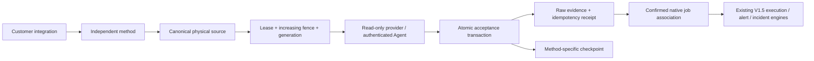

# ARCH-001 V1.6 — Data Pipelines

## Scope and compatibility

V1.6 adds customer-scoped integrations inside **Resource Management → Data Resources → Data Pipelines**. The existing legacy onboarding path remains available. Compute onboarding, VM Agent installation, Event Parameters, Alert Rules, Notifications, schedules, SLA, execution reducers, correlation and native incident transitions retain their V1.5 contracts.

One integration is a platform account/endpoint/environment boundary, with immutable connection versions, capability profiles, independent collection methods and explicit native job selection. The wizard has exactly eight stages: General; Platform; Connection; Integration; Collection Sources; Job Discovery/Selection; Source Associations; Validate & Activate. Draft fields survive closing, refreshing and resuming the wizard. Saving a configuration does not activate monitoring.

Internal departments remain separate from monitored customer organizations. Every new API applies customer scope and backend permissions; a human login cannot use the Agent transport endpoints.

## Implementation matrix

| Area | Status and evidence |
|---|---|
| Eight-step drafts, connections, explicit jobs and source associations | Implemented; real HTTP and desktop/mobile browser checks passed. |
| Fencing, atomic evidence/checkpoints, shared holds and reviewed legacy handoff | Implemented; PostgreSQL race/durability and HTTP transition checks passed. |
| Additive migration and V1.5 compatibility | Populated upgrade, schema drift and downgrade guards verified; protected regressions passed. |
| Platform collection adapters and file transport | Implemented with deterministic tests; genuine nine-platform and native-host acceptance pending. |
| Provider continuity, bounded recovery and installed-version detection | Partial: backend anchor proofs and some provider replay are unavailable; redetection supplies documented capabilities only. Affected paths fail closed. |
| Production activation and post-merge verification | Not performed; this is a reviewable development implementation, not production acceptance. |

## Data and migration mapping

Additive revision **0032_pipeline_ownership**, following **0031_in_app_notifications**, creates ten tables:

| Table | Responsibility |
|---|---|
| pipeline_integrations | Platform/customer/environment boundary, draft stage, enabled state |
| pipeline_connections | Immutable configuration versions, checksum, active version |
| pipeline_capabilities | Installed-version declaration, compatibility and evidence status |
| pipeline_sources | Canonical physical unit, generation, lease, fence, separate cursors |
| pipeline_methods | Integration-to-source reader configuration and health/eligibility |
| pipeline_jobs | Stable native identity, selection, quarantine and stale status |
| pipeline_associations | Operator-confirmed job/method association bound to source generation |
| pipeline_holds | Composed integration, manual, continuity and legal holds |
| pipeline_evidence | Durable raw evidence identity, payload and acceptance outcome |
| pipeline_operations | Idempotent operations, independent review, recovery and audit metadata |

Composite foreign keys reject cross-customer references. Existing organizations, users, departments, resources, executions and historical evidence are retained. No existing customer UUID is reused as an employee department identity.

Selected jobs project onto existing `MonitoringResource`/`JobOrder` identities through a non-executing `PIPELINE_V16_PROXY` Collector. Only evidence matched to a confirmed native job reaches the existing reconstruction path. Display names never establish identity. Unmatched or conflicting evidence is quarantined. Existing `HOSTED_ON` relationships are retained; sharing a source never creates execution dependencies.

The reviewed legacy handoff acquires the same legacy Collector advisory lock, requires one explicitly confirmed resource association, preserves the original Collector UUID/configuration/history/runtime checkpoint, archives its checkpoint and retires its independent polling by changing it to the proxy type. It does not silently associate arbitrary legacy resources. Legacy bindings start quarantined (`LEGACY_PENDING`) and cannot be selected before the independent handoff confirms the exact native ID/platform/environment. Resource activation and monitoring are paused until explicit selection, current-generation associations and genuine eligibility are restored. Source rollback does not automatically restart the independent legacy poller; reversing a complete legacy migration requires its documented backup/reverse-transition procedure.

## Fenced collection and suspension



Claims and commits lock the source row. Every commit checks the current owner, live lease, fence, source generation, suspension and capability eligibility. Raw evidence, idempotency receipt, V1.5 projection and checkpoint update share one PostgreSQL transaction. A delayed owner with fence 41 cannot commit after fence 42 succeeds. Source changes invalidate previous-generation associations and runtime proofs.

Pausing an integration creates durable holds on all referenced sources, including shared sources. Manual holds compose with integration holds. Legal holds protect retention; they are released only by an independent administrator. Collection and failover are denied while collection holds remain. Clearing one hold does not bypass other holds or checkpoint continuity validation.

Source changes use impact preview, independent administrator approval, a revision/generation check, fenced handoff and a checkpoint archive. Rollback preview creates another reviewed generation transition, restores the archived identity, cursor and method/connection/capability references, and requires continuity validation. Changed method membership rejects the old rollback plan. Restoring configuration never silently restores runtime eligibility. Changing native account/physical authority requires a new integration/job identity. Shared connection replacement must satisfy each affected integration's ownership; unsupported remapping is rejected.

## Collection, discovery and recovery

Read-only V1.5 adapters are reused for Pentaho PDI, IICS, Airflow, NiFi, Azure Data Factory, AWS Glue, SSIS, Talend and Custom/Shell. Glue uses its region-derived endpoint, 12-digit account and `region:<region>` source scope; the worker checks STS caller identity and job ARN authority before collection. Provision `opsc-pipeline-<customer-uuid-without-hyphens>-<name>` AWS profiles for that customer; default backend credentials and another customer's profiles cannot be delegated. New collection transports are platform API, structured File Log and supported database collection. Unsupported platform/method combinations remain ineligible.

Platform APIs use customer-bound managed secret references and existing approved egress validation. Provision variables named `OPSCONTROL_PIPELINE_SECRET_<CUSTOMER_UUID_WITHOUT_HYPHENS_UPPERCASE>_<NAME>` in the backend environment and use `env:` references to them. Other customer namespaces and application/Agent credential variables are rejected. Existing V1.5 references are unaffected. Do not commit secret values. Airflow/IICS/Glue retain independent native-job cursors and bounded round-robin polling. Azure identities are factory-qualified ARM pipeline IDs. SSIS uses project ID plus package GUID and deployment-version joins, avoiding attribution of old package deployments to a new identity. SSIS selected-job queries are explicitly bounded to 100 jobs; larger selections fail with a visible limit rather than omit jobs silently.

Global discovery cadence is 24 hours and redetection is seven days, with on-demand operations. Discovery never selects jobs automatically. Only complete authorized inventories can mark absent jobs stale. Renames retain native job UUIDs. Ambiguous/manual-discovered matches require operator confirmation. Pentaho Carte running-status inventories and Custom/Shell do not constitute an authoritative persistent catalogue; these use manual native identity registration rather than unsafe absence reconciliation. Static adapter capability descriptions remain documented evidence, not runtime verification.

The optional structured-log client is served by `/api/v1/data-pipelines/agent-client` and lives in `backend/app/data_pipelines/transport.py`. It uses an existing resource-bound Agent identity and verified HTTPS, claims before reading, supports independent file paths, retains partial lines, bounds reads, and advances only backend-owned cursors after acknowledgement. Distinct byte offsets remain distinct even when messages and timestamps match. Rotation/truncation stop collection until an evidence-based continuity/recovery or reviewed generation transition is provided. Existing VM file receivers must relinquish the exact source before this transport may claim it.

Example (keep the existing identity file private; do not copy its contents into forms):

```sh
python transport.py --backend https://opscontrol.example.test \
  --identity-file /var/lib/opscontrol-agent/identity.json \
  --ca-file /etc/opscontrol-agent/ca.pem --source-id SOURCE_UUID
```

Recovery uses a different cursor and durable range operation. Live collection has priority. Automatic bounds are six hours for File Log and 24 hours for platform/database sources, including maximum lookback. Beyond-bound recovery requires independent approval. Current executable bounded replay covers structured files and the supported ADF/NiFi request ranges. Other backend providers stop with `BOUNDED_PROVIDER_REPLAY_NOT_SUPPORTED`; they are not retried indefinitely or represented as recovered. Backend post-handoff continuity without a provider-supported anchor proof is explicitly blocked. These are remaining implementation limitations, separate from deferred live acceptance.

File continuity challenges are short-lived, generation/cursor-bound and require authenticated filesystem observations matching saved inode/device/offset. Readable paths in the UI alone do not establish filesystem permission or continuity. Backend sources do not gain continuity from an HTTP connection check.

## Activation and runtime acceptance

All newly declared profiles default to unverified. Pentaho version catalogue entries are candidates; the installed version remains unknown. A connection test, fixture, documentation or unit test never enables a method. Activation requires genuine accepted native evidence, a matching reader-definition hash/source generation, independently attested runtime capability, current confirmed associations, continuity and the existing V1.5 resource readiness checks.

Genuine runtime verification is disabled by default. Its separately approved workflow requires `OPSCONTROL_PIPELINE_RUNTIME_ACCEPTANCE=1`, an independently approved verification operation and an actual installed version. This implementation did not enable that switch or contact a live vendor. Source edits invalidate eligibility until the new reader is verified.

## Retention

Daily cleanup removes eligible raw evidence after 30 days, unprotected inactive cursors after 14 days, unselected unreferenced stale jobs seven days after qualifying discovery, and gap metadata after 30 days. Selected stale jobs are protected indefinitely. Legal holds protect associated retained data and require independent release. Configuration retirement is soft and never cascades into raw evidence or execution history. V1.5 projections contain normalized events and evidence references, keeping duplicate raw provider payloads out of longer-lived histories. Runtime attestation metadata survives raw-payload retirement without retaining the raw provider payload. Audit records are not pruned by this cleanup, preserving at least the 365-day requirement. Cleanup batches are bounded; high-volume operators must measure backlog before deployment.

## APIs

The `/api/v1/data-pipelines` router exposes integration CRUD/drafts, immutable connection versions, capability profiles, methods and validation, paginated jobs, explicit selection/manual discovery reconciliation, generation-bound associations, activation/suspension, source impact and holds, recovery plans, reviewed source changes/rollback previews, operation status and paginated evidence. Mutation DTOs reject extra fields and plaintext credential keys. Repeated operation keys with different target/payload are rejected. Optimistic revisions protect edits.

The machine-only `/api/v1/agent/pipeline-claim`, `/pipeline-evidence` and `/pipeline-continuity` routes reuse authenticated Agent identity, revocation, host and customer binding. They cannot be called with a human bearer token.

## Verification and local commands

```sh
# Existing dependencies; Docker is required for the owned PostgreSQL lab.
make test-pipeline-v16
V16_API_ACCEPTANCE=1 V16_BROWSER_ACCEPTANCE=1 \
  backend/.venv/bin/python scripts/v16-acceptance.py
# Set PLAYWRIGHT_MODULE / PLAYWRIGHT_CHROMIUM_EXECUTABLE for your installation.
npm run lint --prefix frontend
npm test --prefix frontend
npm run build --prefix frontend
make test-docker
```

The owned lab creates and removes only its randomized PostgreSQL container. It upgrades a populated V1.5 customer, checks zero model/schema drift, tests empty downgrade/re-upgrade and rejects populated downgrade before any table removal. Save a database backup before upgrading any persistent local demo:

```sh
mkdir -p .demo-private/backups
docker compose -f docker-compose.demo.yml exec -T postgres \
  pg_dump -U opscontrol -d opscontrol -Fc > .demo-private/backups/pre-v16.dump
docker compose -f docker-compose.demo.yml exec -T postgres \
  pg_restore --list < .demo-private/backups/pre-v16.dump >/dev/null
docker compose -f docker-compose.demo.yml up --build -d
```

Restore into an isolated database first and compare record counts before using a backup for rollback. Populated V1.6 downgrade intentionally refuses; preserve/export V1.6 records or restore a verified pre-upgrade backup with the matching V1.5 image. Never discard new evidence merely to downgrade schema.

Actual verification artifacts are in [verification/arch001-v16](verification/arch001-v16). They distinguish hypothetical preverified ownership fixtures from live vendor acceptance. Local results: 20 actual PostgreSQL tests; 107 focused backend tests (including thirteen file/native identity/security tests); six frontend authorization tests; nine real HTTP acceptance groups; actual desktop/mobile Playwright wizard and draft-resume checks; frontend lint/build; additive migration checks. No production or vendor environment was accessed. Docker frontend/backend/worker images built successfully. The isolated five-service Compose stack passed startup, migrations, restart/session persistence, authentication and frontend security-header checks after recovering unused Docker build-cache capacity. The existing V1.5 demo was preserved. The Docker run preceded the final legacy-handoff and retention fixes; the final source was subsequently exercised by the PostgreSQL, HTTP and browser lab. An exact-head Docker rebuild remains a CI/reviewer check.


## Nine-platform acceptance and deployment forecast

| Platform | Acceptance dependency / principal risk |
|---|---|
| Pentaho | Installed version unknown; Carte inventory lacks persistent native job identity. Validate structured-log or supported execution-store identity before enabling. |
| IICS | Actual edition/API/session headers, task IDs, account scope and pagination must match the declared profile. |
| Airflow | Confirm installed REST API version, RBAC, stable DAG IDs and pagination; measure round-robin collection latency. |
| NiFi | Confirm process-group/processor semantics, permissions and bounded replay coverage. |
| Azure Data Factory | Validate ARM authority, factory-qualified pipeline IDs, token renewal and timestamp query bounds. |
| AWS Glue | Approved IAM/account/region, STS identity, job ARNs, API limits and restart/checkpoint behavior remain unverified. |
| SSIS | Native ODBC driver, least-privilege SSISDB permissions and package deployment-version mapping are mandatory. |
| Talend | Confirm regional API version, task identifiers, authentication and pagination. |
| Custom/Shell | Producer must emit stable native IDs and normalized structured events; restart/rotation permissions must be validated on the target host. |

Local control-plane confidence is supported by the executed checks. Nine-platform production acceptance remains **unverified**, and production activation should stay blocked. A defensible success percentage cannot be inferred from fixtures. Provider account/physical-scope bindings beyond the automated Glue authority check require genuine acceptance against the operator-declared identity; URL validation alone does not prove that binding. Highest deployment risks are provider-native identity mismatch, unavailable continuity/replay after handoff or rotation, and latency/backpressure with large inventories. Before production, perform genuine version-specific acceptance, complete provider continuity/recovery coverage, verify host-level transport supervision and overlapping legacy receiver handoffs, and run measured concurrency/retention capacity tests.

No PR merge or production deployment is performed by these commands.
