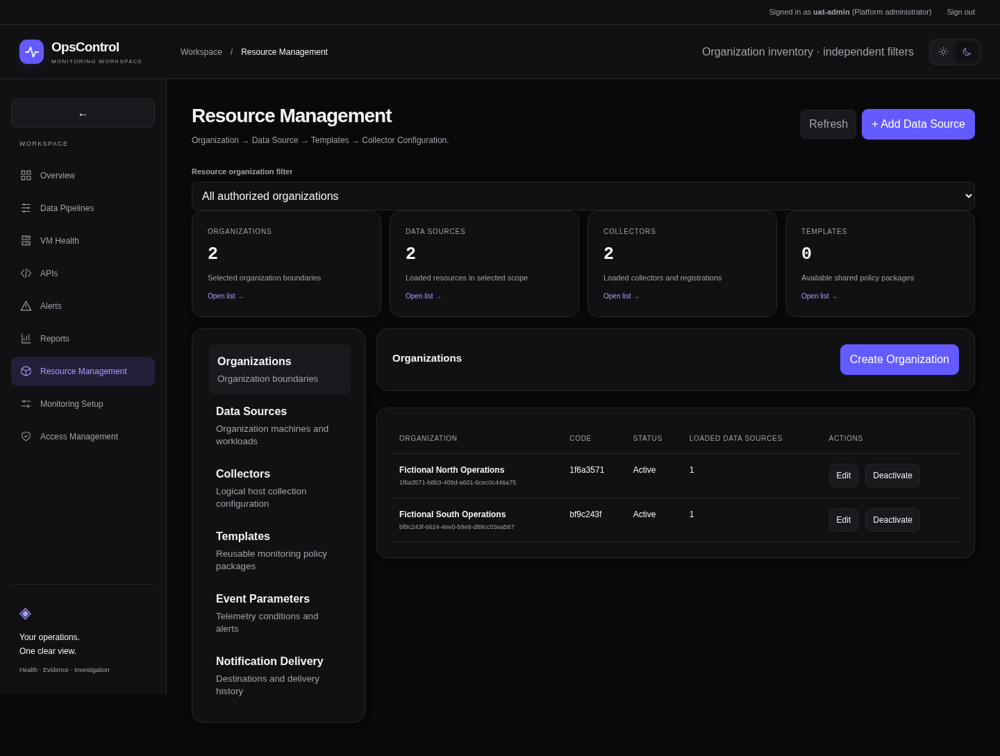
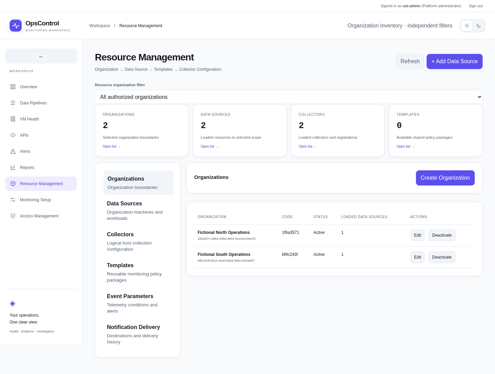
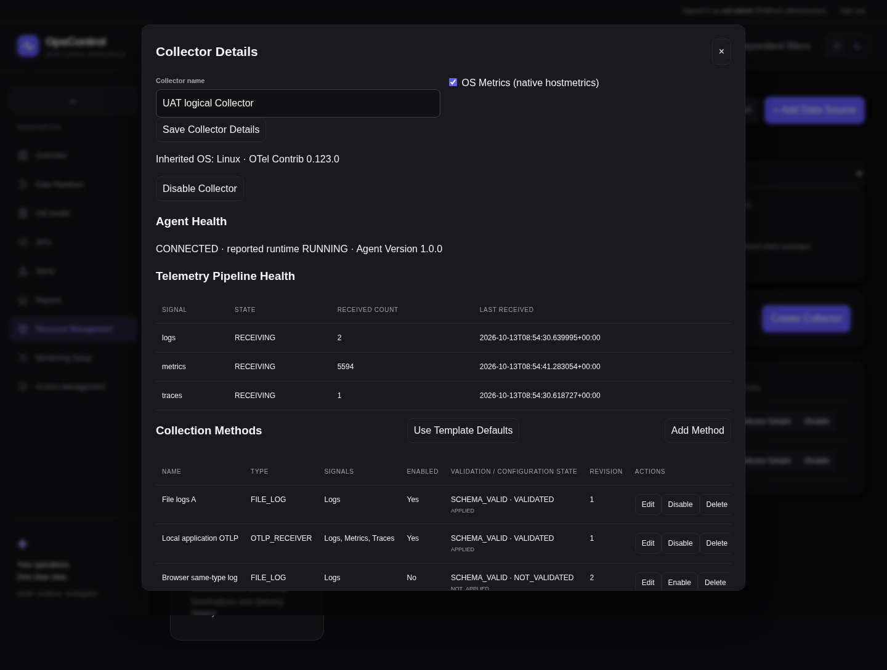
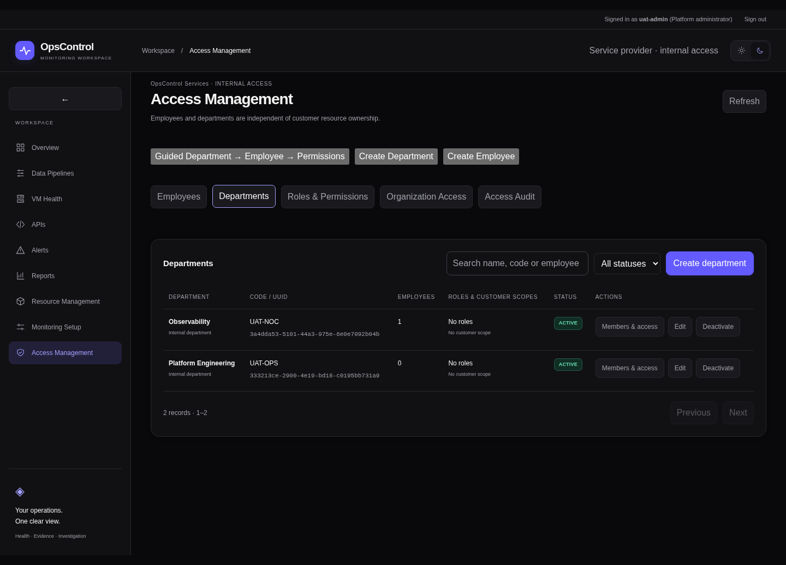

# Consolidated manual UAT: implementation and verification

This feature branch implements the revised collector/agent, access and alert-only monitoring architecture. Existing approved PRs #30 and #31 are merged; this UAT feature is delivered through a dedicated PR, with owner-authorized merge after validation; production deployment remains separate. Controlled acceptance never modifies production data.

## Implemented modules

| Module | Result |
|---|---|
| Resource UI | Compact Organizations, Data Sources and Collectors tables; standalone Create Collector; inherited Data Source OS; independent Event Parameters and Notification Delivery tabs; wide-table scrolling and wrapped identifiers |
| Navigation | Data Pipelines display terminology, accessible collapsible main sidebar and persistent dark/light themes; Incidents navigation/pages removed |
| Access | Department → Employee → Permissions guide, independent create actions, existing employee search, role/scope previews and backend ownership/delegation checks |
| Methods | Typed File Log, Metric Scrape and OTLP Receiver schemas; stable UUIDs, repeatable same-type methods, optimistic revisions and independent CRUD/enable/disable/soft-delete |
| Host agent | Secure one-time enrollment, reused customer-bound WorkerIdentity credentials, one agent per Collector, OS/version checks, authenticated heartbeat/configuration pull, approval/application history and revision rollback metadata |
| OTel | Pinned actual Contrib validation, unique receiver names, selected-signal pipelines, native hostmetrics, memory/batch processors, local health extension and secure OpsControl OTLP exporter |
| Ingestion | Real OTLP/HTTP protobuf/JSON and bounded gzip; actual log/metric/span persistence, independent receipt timestamps/counts and batch retry deduplication |
| Rules | Existing AlertRule/AlertState engine; percentage thresholds, minimum event counts, full sustained windows/gap checks, dynamic baselines/combined thresholds, deduplication and automatic recovery |
| Delivery | Existing fenced leased queue; scoped in-app/SMTP/webhook destinations, references, bounded exponential backoff, per-destination throttling, grouping metadata, acknowledgment/escalation and delivery outcomes/queue lag |

The third new Resource Management tab has not been specified and is not invented. Existing monitoring adapters/templates remain available; API Polling, Cloud Ingestion and Syslog are not new top-level methods.

## Models and migration

`0026_managed_telemetry_uat` follows `0025_provider_department_rbac`. It creates `collector_methods`, `managed_agents`, `agent_registrations`, `collector_config_versions`, `agent_deployments`, `telemetry_receipts`, `trace_spans` and `notification_destinations`. It adds nullable AlertRule evaluation configuration and AlertState acknowledgment fields. Worker credentials, existing resource records and monitoring rule/state tables are reused.

Customers remain `organizations`; Departments remain provider-owned. Existing users/password hashes/sessions and resource foreign keys are retained. The known seeded default provider example is renamed to OpsControl Services only when its deterministic UUID, DEFAULT code and original example name match; customized provider names and customer records are untouched.

Existing equivalent incident-role capabilities map to narrower monitoring-alert permissions. Retired permission rows remain historical data, but are excluded from active catalog/delegation/resolution. The protected platform-admin flag remains the break-glass boundary. No new permission can grant that flag through ordinary role assignment.

New ordinary employee creation requires one existing department, including the legacy identity-create route. Existing unassigned identities and multiple-department memberships survive migration. A trigger rejects future extra active memberships while preserving those historical rows. Authorized explicit transfer changes the membership in one transaction. Existing multiple memberships must be reviewed/transferred deliberately; migration does not silently narrow inherited access.

An empty new schema can downgrade to 0025 in a disposable fixture. Populated method/agent/telemetry/destination or event-rule data causes downgrade to refuse. Preserve the additive schema for an application rollback, and use the documented backup/recovery process for a separately approved restoration. Do not apply an autogenerated destructive migration.

## Removed ITSM behavior

Incident pages, operational incident APIs, incident projection service and ServiceNow/PagerDuty adapters are removed. Polling/ETL evidence no longer creates operational incident episodes. Existing incident tables and archived records/triggers are retained; legacy ETL event/table/column names remain compatible where they store monitoring evidence. No incident records are silently deleted. Retired delivery records are excluded from active notification claims.

Monitoring alerts remain separate OPEN/RESOLVED episodes with real evaluation/receipt history and acknowledgment metadata. Correlation, pipeline investigation notes, source logs and execution history remain operational. Notification destinations do not require an ITSM provider.

## API surface

| API | Purpose |
|---|---|
| `GET /api/v1/agent-control/collectors/{id}` | Methods, inherited OS, agent state, real signal receipt summaries, revisions and deployment history |
| `POST /…/{id}/methods`, `PUT/DELETE /…/{id}/methods/{method_id}` | Scoped method CRUD and optimistic revision checks |
| `GET /…/{id}/template-defaults` | Resolved attached-template draft methods and missing-attribute warnings; no automatic saving or deployment |
| `GET /…/{id}/preview`, `POST /…/{id}/versions` | Preview/download YAML and actual runtime validation when provisioned |
| `POST /…/{id}/registration`, `DELETE /…/{id}/agent` | Issue expiring one-time enrollment or revoke agent credentials |
| `POST /…/{id}/apply` | Explicitly approve a validated configuration revision, including rollback/reapply |
| `GET /api/v1/agent-control/packages/{linux\|windows}` | Authenticated downloads of operator-provisioned approved packages; 503 when unavailable |
| `POST /api/v1/agent/register`, `POST /api/v1/agent/heartbeat`, `GET /api/v1/agent/configuration` | Enrollment and authenticated agent pull/reporting |
| `POST /api/v1/agent/otlp/v1/{logs\|metrics\|traces}` | Actual customer/Collector-bound OTLP ingestion |
| `GET/POST /api/v1/event-parameters`, `PUT /…/{id}`, `/metrics`, `/preview` | Saved rules, compatible metric selection and explicitly stored-data preview |
| `GET/POST /api/v1/notification-delivery`, `PUT /…/{id}` | Scoped destination settings and actual delivery tracking |
| `GET /api/v1/operations/alerts`, `POST /…/{id}/acknowledge` | Monitoring alert evidence and scoped acknowledgment |
| `PUT /api/v1/access/employees/{id}/department` | Authorized atomic single-department transfer |

Authorization checks run in API/service functions and the existing default-deny ORM scope layer. Agent endpoints authenticate their separate identities and never accept user-supplied customer ownership. Secrets/passwords are not returned in ordinary responses or logged. Enrollment and the initial identity credential are disclosed only once to the authorized caller; persisted values are hashes or protected target credentials. Configuration contains references, never raw keys.

## Operator setup

1. Create/select an Organization, Data Source and host Collector. The OS belongs to the Data Source. Existing Other OS inventory cannot enroll a host agent.
2. Add enabled methods and/or native OS Metrics. Preview YAML and configure an actual trusted HTTPS backend origin in `OPSCONTROL_PUBLIC_INGESTION_URL`.
3. Provision the exact compatible `OPSCONTROL_OTEL_BINARY`. Without a binary, saved revisions are UNVALIDATED and application is blocked. Validation checks receiver compatibility; it does not grant host file permissions or prove telemetry reception.
4. Build checksum-verified packages and provision `OPSCONTROL_AGENT_PACKAGE_DIR` if dashboard download is required. Follow [Linux/systemd and Windows Service installation](../agent/README.md). No secure remote installation channel is implemented.
5. Create one-time enrollment, install/register locally on the approved host, and explicitly approve Apply Configuration. Review agent-reported runtime state and separate actual Logs/Metrics/Traces receipt counters/timestamps.
6. Configure Event Parameters only for compatible percentage signals. Dynamic rules require sufficient historical baseline data; missing/gapped observations cannot establish a sustained breach.
7. Configure Notification Delivery destinations and route rules to their IDs. Enable the existing collector worker for leased delivery. SMTP/webhook destinations require deployment-owned `OPSCONTROL_NOTIFICATION_ALLOWED_HOSTS` and `OPSCONTROL_NOTIFICATION_ALLOWED_CIDRS`; the default is deny. Provision referenced secrets outside the database. `OPSCONTROL_NOTIFICATION_THROTTLE_SECONDS` defaults to one second and is bounded to 0–300 seconds.

Target-side receiver/scrape authentication uses protected `env:NAME` references. Remote OTLP listeners require explicit binding approval, TLS and authentication. The backend supports authenticated OTLP/HTTP export; gRPC is an application-to-agent receiver option, not an unauthenticated public backend listener.

## Exact local validation commands

From the repository root, with Docker Engine running:

```bash
python3 -m venv backend/.venv
backend/.venv/bin/pip install -r backend/requirements-providers.txt -r backend/requirements-hosts.txt
npm ci --prefix frontend
(cd backend && .venv/bin/python -m unittest discover -s tests -v)
npm test --prefix frontend
npm run build --prefix frontend
bash -n agent/install-linux.sh
```

Extract the pinned official Contrib runtime for real validation:

```bash
docker pull otel/opentelemetry-collector-contrib:0.123.0@sha256:e39311df1f3d941923c00da79ac7ba6269124a870ee87e3c3ad24d60f8aee4d2
docker create --name opscontrol-uat-binary --network none otel/opentelemetry-collector-contrib:0.123.0@sha256:e39311df1f3d941923c00da79ac7ba6269124a870ee87e3c3ad24d60f8aee4d2
docker cp opscontrol-uat-binary:/otelcol-contrib /tmp/opscontrol-otelcol-contrib
docker rm opscontrol-uat-binary
export OPSCONTROL_OTEL_BINARY=/tmp/opscontrol-otelcol-contrib
backend/.venv/bin/python scripts/uat/acceptance.py
```

The script owns a randomly named PostgreSQL container, generated private credentials, certificate-verified TLS API and the actual upstream Collector process. It tests populated upgrade, empty additive downgrade/upgrade, full Alembic comparison, method/security/agent/rule/delivery behavior and refuses populated rollback. It cleans only its own processes/container; existing development volumes are untouched. Controlled percentage samples are labeled synthetic, while filelog/hostmetrics/trace transport actually runs through Contrib.

For actual Playwright journeys and screenshots:

```bash
npm install --prefix /tmp/opscontrol-uat-browser --no-audit --no-fund playwright@1.56.1
/tmp/opscontrol-uat-browser/node_modules/.bin/playwright install --with-deps chromium
export PLAYWRIGHT_MODULE=/tmp/opscontrol-uat-browser/node_modules/playwright/index.mjs
UAT_BROWSER_ACCEPTANCE=1 backend/.venv/bin/python scripts/uat/acceptance.py
```

The fixture trusts only its generated TLS key in Chromium; it does not disable global certificate validation. Browser tooling remains outside application dependencies.

For a clean owned Docker build/bootstrap/restart check, then persistent local exploration:

```bash
backend/.venv/bin/python scripts/access-docker-demo.py
bash scripts/demo-up.sh
docker compose -f docker-compose.demo.yml exec -T api alembic current
docker compose -f docker-compose.demo.yml exec -T api alembic check
```

Expected head: `0026_managed_telemetry_uat`. Use `bash scripts/demo-down.sh` to stop the persistent demo and preserve its database. Enterprise CA builds follow the existing trusted ephemeral build-secret guide; do not disable TLS verification.

## Acceptance limits

Native Windows service/receiver acceptance requires an actual approved Windows host and compatible binary; local Linux tests do not certify it. SMTP/webhook production credentials and delivery infrastructure need separate provider acceptance. Linux/systemd installation scripts are provided; actual target installation and production application require explicit operator approval. A saved configuration or package download is not installation, deployment or reception evidence.

Histogram/summary OTLP ingestion stores count/sum series; a full histogram query engine and trace investigation explorer are not implemented. Lists/history are bounded. Retention of new trace/receipt/configuration history needs an approved operational policy before production scale. Legacy multiple departments/unassigned identities remain visible until deliberately reconciled. Genuine cloud/Carte acceptance and independent security review/UAT remain owner/environment gates. The unspecified third tab remains a product decision.

Actual runtime/browser results, source hashes and captures are recorded in `docs/screenshots/consolidated-uat/`; the PR diff is the authoritative file-change inventory. Failed/private diagnostics, credentials and database dumps are never committed.

## Recorded local validation

| Gate | Result |
|---|---|
| Backend unit regression | 48 tests pass, including sustained-window gaps, dynamic baselines and unavailable-validator behavior |
| Frontend tests/build | 4 tests pass; Vite production build passes |
| Access security / browser | 25 backend groups and 7 real Chromium groups pass; existing sessions enforce changes |
| Operational regression | Real TLS HTTP failure/recovery, controlled read-only Carte lifecycle, Linux host collection, reports, dual themes, worker trust/leases and tenant negatives pass |
| Managed telemetry | Actual Linux supervisor + Contrib 0.123.0, authenticated TLS OTLP logs/metrics/traces, missing-file failure, approved rollback, sustained alert recovery and leased in-app delivery pass |
| Migrations | Populated 0025→0026 preserves data; empty 0026→0025→0026 passes; full Alembic check has zero drift; populated downgrade refuses |
| Release regression | Populated dump/restore hashes and constraints, archived incident preservation, retention, concurrency, TLS/proxy headers and restricted DB roles pass |
| Docker | Clean isolated three-service image build, bootstrap idempotency, schema check and API restart/session preservation pass; existing volumes untouched |
| Packaging | Approved Linux runtime checksum, package assembly and archive integrity pass; Linux installer shell syntax passes |
| Skipped target acceptance | Native Windows service/receiver, actual Linux systemd installation, genuine SMTP/webhook credentials, genuine AWS/Carte and production scale/failover |

The release fixture includes an explicitly archived synthetic incident record only to test preservation of historical data and constraints. The running monitoring application never creates that fixture or new incident episodes.

### Actual browser captures






See [exact changed-file inventory](screenshots/consolidated-uat/changed-files.txt), [API inventory](screenshots/consolidated-uat/api-inventory.json), [source/evidence hashes](screenshots/consolidated-uat/manifest.json) and the redacted JSON gate reports in the same directory. Remote CI status is recorded in the PR; local evidence does not substitute for independent human review.
