# Operational telemetry, alert and notification lifecycle

The implementation keeps the existing FastAPI/SQLAlchemy/PostgreSQL/React architecture. The requested sequence verifies it and closes gaps, rather than replacing state management or data contracts. Appearance remains the approved dark/light UI; Resource Management uses bounded batches of the same collector endpoint to respect ingress URL limits.

Worker liveness does not create a health sample or mark a source healthy. Basic usernames/passwords resolve on the worker after independent local destination/reference approval; only references cross job dispatch. Basic result mode prevents accidentally accepting an old anonymous-only agent for an authenticated job, while the worker remains a trusted measurement boundary. No raw response body/credential enters remote evidence.

Notification Delivery uses the existing outbox with fenced leases. Claim/finalize are short transactions; provider network calls execute outside the claim transaction. Completion is conditional on the current unexpired token. SMTP and webhooks use deployment-owned destination allowlists, verified TLS and protected secret references; in-app delivery is independently usable. Stable delivery IDs support provider idempotency, and retry/backoff, throttling and escalation remain separate from monitoring alert acknowledgment/recovery. Incident/ITSM APIs and ServiceNow adapters are retired; historical records and migrations remain intact.

EKS inventory validates account/region/cluster identity through workload SDK reads; it never uses returned endpoints/certificates to reach a cluster and never creates an unsupported collector. In-cluster Pod/Deployment/Node telemetry is a separate explicitly deployed Kubernetes service-account adapter. Production multi-host affinity/overall deadlines/real namespace routing still need target acceptance.

Migrations 0023/0024 add worker liveness and notification leases. Production startup requires these fields plus restricted non-owner/non-audit-mutator capability checks. Rollback retains compatible additive schema and aligns agent/API/dispatcher versions; old main read/auth compatibility is not a guarantee for new feature configurations. Concurrent-index DDL rollback/upgrade is exercised without dropping later populated columns, and full populated restore preserves every tested row/constraint.

[Controlled execution ledgers](OPERATIONAL_RELEASE_SEQUENCE.md), [deployment/UAT](DEPLOYMENT_UAT.md) and [OWASP exact verification](security/OWASP_API_2023_CHECKLIST.md) state remaining independent/deployed/live-provider acceptance. No production rollout or real external notification delivery is performed by the acceptance labs.

## Independent identity administration and customer ownership

[Customer/department RBAC architecture](architecture/CUSTOMER_DEPARTMENT_RBAC.md) preserves the monitoring graph above: every customer resource FK still references `organizations`. Provider-owned departments, existing user identities, configurable roles and paired customer grants are an independent graph. Exact action permissions narrow the request-scoped ORM customer boundary; the selected customer is only an additional filter. Access Management queries use explicit provider/service authorization and never global selector state. Existing sessions re-resolve current rights, and remote service identities retain their independently bound customer/job scope. Migration 0025 preserves old hashes, sessions and resource identities; unknown legacy roles abort transactionally. Retain additive schema during rollback and never run an older authorization backend that ignores new restrictions.

## Managed host telemetry

```mermaid
flowchart LR
  UI[Logical Collector + repeatable Collection Methods] --> CFG[Validated versioned Contrib YAML]
  CFG --> APPROVE[Explicit Apply Configuration approval]
  APPROVE --> AGENT[Authenticated OpsControl Agent configuration pull]
  AGENT --> OTEL[Managed Contrib runtime on one Windows/Linux host]
  OTEL --> INGEST[Authenticated HTTPS OTLP logs/metrics/traces]
  INGEST --> DB[(Organization-bound PostgreSQL evidence)]
  DB --> ALERT[Existing alert evaluation and deduplication]
  ALERT --> DELIVERY[Independent notification queue]
```

Migration `0026_managed_telemetry_uat` adds method, agent, revision/deployment, receipt/span and destination data without replacing the existing ownership graph. A Collector is a logical entity, not an executable process. The installed OpsControl Agent supervises upstream Contrib; successful configuration saving, application, heartbeat and actual signal reception are distinct states. Target file permissions are checked by the service identity. Templates offer explicitly reviewed drafts using Data Source overrides, never automatic installation. See [implementation, API inventory and verification](CONSOLIDATED_UAT.md) and [host installation](../agent/README.md).
