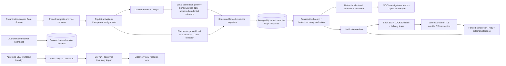

# Operational collector and incident lifecycle

The implementation keeps the existing FastAPI/SQLAlchemy/PostgreSQL/React architecture. The requested sequence verifies it and closes gaps, rather than replacing state management or data contracts. Appearance remains the approved dark/light UI; Resource Management uses bounded batches of the same collector endpoint to respect ingress URL limits.

Worker liveness does not create a health sample or mark a source healthy. Basic usernames/passwords resolve on the worker after independent local destination/reference approval; only references cross job dispatch. Basic result mode prevents accidentally accepting an old anonymous-only agent for an authenticated job, while the worker remains a trusted measurement boundary. No raw response body/credential enters remote evidence.

ServiceNow uses the existing outbox with nullable lease fields. Claim/finalize are short transactions; no DB connection/lock is held while a provider is called. Completion is conditional on the current unexpired token. Opening correlation/reference is reused by recovery and retry; malformed/missing IDs, redirects and unsafe responses cannot produce SENT evidence. Native operator incident transitions remain separate from external incident state.

EKS inventory validates account/region/cluster identity through workload SDK reads; it never uses returned endpoints/certificates to reach a cluster and never creates an unsupported collector. In-cluster Pod/Deployment/Node telemetry is a separate explicitly deployed Kubernetes service-account adapter. Production multi-host affinity/overall deadlines/real namespace routing still need target acceptance.

Migrations 0023/0024 add worker liveness and notification leases. Production startup requires these fields plus restricted non-owner/non-audit-mutator capability checks. Rollback retains compatible additive schema and aligns agent/API/dispatcher versions; old main read/auth compatibility is not a guarantee for new feature configurations. Concurrent-index DDL rollback/upgrade is exercised without dropping later populated columns, and full populated restore preserves every tested row/constraint.

[Controlled execution ledgers](OPERATIONAL_RELEASE_SEQUENCE.md), [deployment/UAT](DEPLOYMENT_UAT.md) and [OWASP exact verification](security/OWASP_API_2023_CHECKLIST.md) state remaining independent/deployed/live-provider acceptance. No production rollout or real external incident delivery is performed by the acceptance labs.
