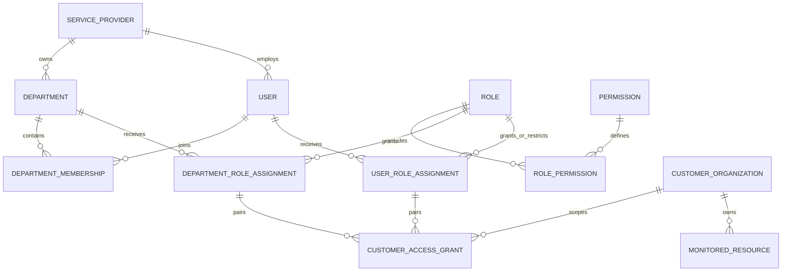

# Customer ownership and internal access architecture

## Impact inventory before implementation

The existing `organizations` table and its VM/application/job/DataSource/collector/evidence/incident/rule foreign keys are customer ownership boundaries. They will not be renamed or repurposed. `organization_memberships` currently grants customer viewer/operator/org_admin access and remains a compatibility source. Existing user UUIDs, password hashes, sessions, and customer/resource UUIDs are preserved.

Identity reads/writes are concentrated in security/models.py, security/http.py and security/scope.py. Customer checks also occur in organizations, rule_catalogs, activation, diagnostics, remote_protocol, discovery and operations APIs and activation_engine. CLI/demo/probe scripts create legacy memberships directly. Frontend App, AuthGate, TopNav, AccessManagement, ResourceManagementV2, MonitoringSetup and incident/investigation controls consume legacy admin/membership state. The machine-readable impact inventory lists every matching source and migration dependency.

## Proposed additive model

Add a minimal single-service-provider ownership record, independent departments, employee metadata on existing users, department memberships, a fixed implemented permission catalog, configurable roles/role permissions, department/user role assignments and customer access grants. All identities use UUIDs. Composite foreign keys enforce provider consistency. Customer grants reference a corresponding role assignment; the role and customer scope are paired instead of taking a cross-product of all roles and all customers. Existing customer relationships stay unchanged.

Departments and employee identities belong to the provider. Optional department codes and employee IDs are unique within that provider. Department manager is metadata, never an implicit administrative privilege. Department and account deactivation are soft operations. Customer records do not become departments. The deployment remains single-provider; enabling multiple independent providers would require an explicit customer-ownership/login-context review.

## Precedence and delegation

Default deny. Active role assignments and explicit customer grants produce allows. Active department membership is required to inherit that department's roles/scopes. An explicit employee customer deny blocks that customer across department and legacy inheritance. Employee role denies remove those permission keys from inherited/direct access. Department grants do not deny other departments. Direct contradictory states are rejected. Customer-specific operations require the relevant permission for that customer, independently of UI selection.

Platform administrator remains the protected break-glass flag, never inferred from an ordinary configurable role. Access administrators have access-administration permissions and controlled delegation authority, not monitoring access. Only platform administrators may delegate access-administration/break-glass authority. Other administrators can configure/assign only the catalog's explicitly delegable monitoring permissions and cannot mutate their own authorization path. Local provider execution and service identity enrollment retain their separate protected authorization boundary.

Legacy viewer/operator/org_admin grants map to explicit compatibility roles with their existing customer scopes and original authority, including existing platform-only restrictions. No legacy user becomes an access administrator. The legacy membership endpoints remain platform-controlled and old direct CLI membership creation remains recognized. Effective-permission previews identify this compatibility provenance; revoking a migrated legacy grant must also revoke its legacy source.

## Migration and rollback contract

Migration is additive. Backfill only provider/employee metadata and equivalent customer-grant records; preserve users, hashes, sessions, customers and all resource foreign keys. New UUIDs are generated independently of customer IDs. No default department memberships or access roles are assigned to existing non-platform users. Validate a populated 0024 database before and after upgrade, including row identities and password/session values.

Keep the additive schema during UI/application rollback. An older backend that understands only legacy memberships may ignore new denies or department access: it is NOT an authorized rollback target after RBAC configuration changes. Roll back only to an RBAC-capable backend, or stop service and prove an exactly equivalent legacy policy under a configuration freeze before any older binary runs. A pre-upgrade backup may be restored only in an isolated verification environment; production recovery needs separate formal approval and a reconciled data-loss plan. Schema downgrade is always refused because it would discard access configuration or employee metadata. Never drop populated departments/grants as a convenience. Migration/restore verification runs only against disposable local PostgreSQL databases, never production.

## UI boundary

Resource Management labels customer organizations as Customers and owns its own customer filter. Access Management has Employees, Departments, Roles & Permissions, Customer Access and Access Audit. The global customer selector is operational-only and is hidden on Resource Management and Access Management. Customer selection neither grants access nor controls internal administration queries. Session authorization is re-evaluated on each request and frontend authorization refresh invalidates stale customer/detail state.

## Implemented model and migration mapping

| Existing data | Upgrade behavior |
|---|---|
| Customer organizations and resource FKs | Preserved byte-for-byte/UUID-for-UUID; no ownership reassignment |
| User UUID, username, hash, active/admin flags | Preserved; provider backfilled and full name initially set to username |
| Human sessions | Digest and expiry preserved; effective permissions re-evaluated on each request |
| Legacy viewer membership | Equivalent Read-Only Viewer paired customer grant; original source preserved |
| Legacy operator membership | Equivalent Legacy Customer Operator paired grant, retaining old restrictions |
| Legacy org_admin membership | Equivalent Legacy Customer Administrator paired grant; no global customer-creation/access-administration privilege added |
| Unknown legacy role | Upgrade aborts transactionally; operator must review an explicit safe mapping |
| Internal departments and employee memberships | Independent new records; existing customers never reused; no automatic department memberships |
| Default service provider and catalog | PTC/DEFAULT provider plus reviewed implemented permissions/roles; ordinary role assignment never creates the platform-admin flag |

User-specific customer DENY requires no role. Role-based ALLOW grants reference an actual assignment by composite FK. Department/customer and employee/customer uniqueness prevent duplicate grants. Provider composite FKs reject cross-provider identity relationships. UUID/provider-owner update triggers protect persistent identities. Manager references are provider-local metadata only. Department deletion is refused; deactivate instead.

Employee/department authorization writes lock their subject with PostgreSQL `FOR NO KEY UPDATE`, compatible with foreign-key key-share locks. This serializes contradictory grant validation with saving. Editing roles locks the role for consistent delegation. Own denied and inactive roles are protected authorization paths too. Changing a department’s active state rechecks authority over its existing roles. Assigned administration identities are protected against another non-platform administrator changing their credentials/account lifecycle/authorization, including inactive-role paths; their own profile/password changes are permitted without changing authority. The last-admin advisory lock is shared with legacy status administration.

Unmirrored memberships created through old API/CLI paths appear as explicit legacy sources in a paginated union, with their membership UUID as the compatibility grant reference. The GET performs no backfill writes, and migration mirrors are not double-counted. Revocation removes the original source rather than leaving a shadow privilege to reappear.

Current global provider permissions and customer grants are shown separately in effective previews. Grant previews run identical validation/constraints inside a rollback-only savepoint. They cannot create a persistent assignment or silently bypass a save-time check. Password values never enter response serialization or audit details.

## Operational validation and limits

See [implementation report and exact local commands](ACCESS_IMPLEMENTATION_REPORT.md). The validated PostgreSQL target is 17 (the grant uniqueness design uses PostgreSQL NULLS NOT DISTINCT). All 32 previously reported non-access schema/model differences are [reconciled against existing migration contracts](SCHEMA_MODEL_RECONCILIATION.md); full schema comparison passes with no new migration or destructive DDL. The owner accepts the single-provider runtime and is conducting independent security review and UAT locally. Migration downgrade always refuses; use an RBAC-capable application rollback with retained schema. Actual production RTO/RPO, real provider acceptance, operator UAT and independent review are not established by disposable fixtures.
