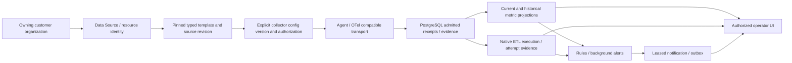

# Sprint 1 E2E architecture alignment — issue95

Version1, 2026-11-09 UTC/Asia/Calcutta. Owner authority: [issue95](https://github.com/Parikshit-Sahrawat/OpsControl_Dashboard/issues/95), including [eight-reference extension](https://github.com/Parikshit-Sahrawat/OpsControl_Dashboard/issues/95#issuecomment-6736751070); parent [issue92](https://github.com/Parikshit-Sahrawat/OpsControl_Dashboard/issues/92). Immutable authority snapshot: [CI005 evidence](../verification/sprint1-integration/ci005-2026-11-09/ISSUE95_AUTHORITY.json), commit dffb7668e3609847b9817a2c500d39e979cd9da9. This bounded documentation/guard patch follows locally verified CI005 source db1109801c76977fd77cd41b24f0ac4cec21a575. It adds no runtime authority, storage engine, database model/migration, API behavior, dashboard redesign or collector transition.

The [workflow matrix](../verification/sprint1-integration/E2E_WORKFLOW_MATRIX.md) and [hashed machine-readable source](../verification/sprint1-integration/E2E_WORKFLOW_MATRIX.json) distinguish current code, executed controlled subpaths and unproven whole journeys. All7 whole paths remain PARTIAL/BLOCKED. This does not erase their passing controlled subpath evidence or fabricate missing provider/UAT acceptance.

Arrows are traceability boundaries, **not a claim that all edges are certified**. A draft stops before operational collection. A saved template/identity does not imply installed collector, successful apply, fresh evidence, workload health, or activation.

## Existing authority and integration boundaries

Source references below are assessed at db1109801c76977fd77cd41b24f0ac4cec21a575; the matrix pins exact source and evidence commits independently.

| Boundary | Current authoritative source | Existing implementation / limitation |
|---|---|---|
|Customer ownership and workforce access|`backend/app/security/scope.py`, `resource_scope.py`, `access_control.py`; Organization/DataSource records|Customer ownership, effective permission and request/write scopes remain authoritative. Departments are workforce entities, not customer organizations. No UI selection grants access. Fresh role/session checks, tenant negatives and revocation evidence are bounded by their actual tests; no global security clearance.|
|Canonical inventory and configuration|`backend/app/unified/api.py`, `services/source_configuration.py`, `api/source_configuration.py`|Resource Management owns identity/configuration. Source-owned immutable revisions retain actor/time, previous/new revision, version pins, overrides and effective snapshot. Required expected revision/command key and transactional writes protect supported clients. Audit is complementary, not a substitute ledger. Historical rollback appends a revalidated revision, never mutates history or implicitly activates collectors. Legacy/older-writer compatibility remains a separately qualified boundary.|
|Typed applicability and collector configuration|`telemetry/configuration.py`, `telemetry/api.py`, `services/source_configuration.py:evaluate/commit`, `frontend/src/components/ResourceTemplateConfiguration.jsx`|OS/resource/source-family/method schema applicability and pinned package validation fail closed. Agent/configuration version, source revision/generation/fence and current authorization are separate identities. No display name is a durable owner identifier. An unverified native provider cannot become qualified merely by resolving a template.|
|Collection and admission|`agent/opscontrol_agent.py`, `telemetry/api.py`, `telemetry/ingestion.py`, `api/remote_protocol.py`|Enrollment/config fetch, transport, tenant/source fencing and admitted PostgreSQL evidence exist; actual0.123.0 Contrib/TLS signal tests are controlled evidence. Request acknowledgment, dedup identity and DB commit are relevant only to the specific admission transaction. Post-admission receipt persistence is not proof that every producer event reached admission. Checkpoint advancement is not delivery.|
|Freshness and operational projections|`unified/engines.py:source_readiness/evaluate_vm/evaluate_api/cycle`, `frontend/src/pages/VMHealth.jsx`, `APIs.jsx`|Collector connectivity, last evidence time, source generation, configuration readiness, monitoring activation and workload health must remain distinct. Missing/stale/unknown evidence must not become green health. Clock/freshness policy and genuine native capabilities require versioned evidence; no new policy semantics are authorized here.|
|Native ETL evidence|`pipeline_adapters/pentaho_carte.py`, `unified/pentaho_execution.py`, `pentaho_schedule.py`, ETL binding models/APIs and OC-ETL-005/007 contracts|Native target identity, execution identity, attempts, steps and completion evidence are distinct from a time-series sample. A scrape success, generic RUNNING collector, missing log or metric threshold cannot prove native completion or NO_RUN. Schedule authority differs from Carte execution/status. Controlled reconstruction/window tests are not genuine Pentaho qualification; D07/D08 and exact-build qualification remain pending. No Run, Retry, Stop, dispatch or scheduler controls.|
|Rules and background delivery|`worker/alert_engine.py`, `unified/engines.py`, `native_incidents/service.py`, `worker/notifications.py`, `telemetry/inbox.py`, `telemetry/delivery.py`|Background alert lifecycle/correlation/recovery and retained event history persist. Lease/retry/idempotency and in-app receipt tests are bounded; they do not independently certify external SMTP/PagerDuty delivery. AUTH-491=B / AUTH-495=C distinguish assumed external closure from provider-verified closure. Incidents management navigation/routes remain excluded.|
|UI and historical analysis|`frontend/src/controlPlane.js`, `pages/UnifiedResourceManagement.jsx`, `DomainReports.jsx`, `Reports.jsx`, `UnifiedOverview.jsx`|UI consumes scoped evidence and never becomes a second configuration authority. Actual identity saves, drafts, CAS/conflicts and browser reload are tested. Full independent history-range/frequency/aggregation correctness remains an explicit matrix gap; a rendered chart or HTTP200 does not verify it.|

Configuration/audit history must contain no secret values, enrollment/session credentials or telemetry checkpoints. Store only approved references and redacted configuration/provenance; operational secret recovery and checkpoint rollback have separate contracts. This patch does not add credential or checkpoint storage to the revision ledger.

## Durable handoff and recovery limits

Central PostgreSQL durable spool is the approved architecture direction. Existing admitted receipts, configuration command idempotency, agent checkpoints and notification leases must not be relabelled as a completed, independently verified central spool or exactly-once source delivery.

Historical CHK-001 loss remains FAIL: guarded0.123.0 admitted/recovery experiments include267 expected/257 persisted/10 missing; a newer experimental binary lost9 at partial re-enqueue. Bounded replay fixture recovery is not authority to deploy replay. Accepted source inventory, durable enqueue/ack atomicity, leases/fencing, retries, duplicates, retention expiry, crash cuts and reconciliation require the approved spool contract and independent verification. CHK-002 protobuf downgrade/rollback remains BLOCKED. No capacity increase, fork, version bypass or collector change is proposed here.

## Evidence levels and claim limits

| Level | Meaning / independent prerequisites |
|---|---|
|DESIGNED|Approved documented contract; no implementation or execution implied.|
|IMPLEMENTED|Source exists at an exact SHA; full integration evidence may be incomplete.|
|CONTROLLED_E2E_VERIFIED|A precisely bounded journey passes actual authenticated UI, real API, migrated PostgreSQL, relevant real collector/worker, negative tenant/cross-session/egress and applicable failure/restart/reconciliation tests. Exact hashes/commands/environment and unresolved limits required.|
|GENUINE_PROVIDER_VERIFIED|Separately authorized read-only exact provider build, target/method/source identities, TLS/network/credential scope, evidence and accountable review. Synthetic engine/provider fixtures never qualify.|
|INDEPENDENTLY_ACCEPTED|Separate explicit independent engineering/owner acceptance of the stated boundary, not a result emitted by CI.|
|RELEASE_ELIGIBLE|All independently required security, legal/NOTICE, durability, migration, provider, UAT and release gates cleared by authorized decisions; no lower level implies this.|

`e2e_alignment.py` checks seven required workflow IDs, explicit statuses/blockers, exact commit/path/hash evidence, source existence, JSON/Markdown agreement and minimum declared real-component boundaries for controlled whole-path claims. It rejects higher certification claims under this controlled-only authorization. **This static guard validates claim structure and provenance; it cannot prove execution or human approval from self-declared flags.** Root CI tests enforce it without changing workflow/check names or weakening runtime tests. All current rows deliberately retain partial/blocked whole-path status.

## Benchmarking references — eight ideas, no copied implementation

| Reference | Bounded idea | Deferred decisions / prohibitions |
|---|---|---|
|OpenTelemetry|Modular signals, explicit method/schema/version compatibility|No replacement of approved collector/persistence contract or version transition.|
|SigNoz|Cross-signal diagnostic context|No mandatory ClickHouse/database migration.|
|Uptime Kuma|Simple status journey with visible freshness|No reduction in tenant/security boundaries.|
|Prometheus|Metric/label/query/rule discipline and cardinality budgets|No inference of ETL outcome from scrapes; budgets/query semantics need separate review.|
|Grafana|Panel hierarchy, selected time range, history/drilldown/annotations|No cloned UI/assets, Grafana service dependency or redesign in this patch.|
|Sumo Logic|Structured log fields, event search, authorized investigation pivots|No new SIEM; log correlation is not native ETL outcome proof.|
|Datadog|Host/process facets, selected process freshness, grouped alerts/routing|No copied agent/rule syntax, commercial dependency or synthetic HEALTHY state.|
|New Relic|Entity relationships, time context and grouped issue workflows|Relationship provenance and authorization required; no excluded incident-management UI.|

Code, assets, brands, APIs and agent implementations are not copied or introduced. Detailed product choices require individual owner approval after Sprint1. Typography, dashboards, new TSDB, root application licensing, provider policies, cardinality/aggregation semantics and final branding are deferred; issue95 does not approve them.

Kubernetes/EKS/AKS/GKE/OpenShift monitoring/discovery remain excluded (deployment packaging is a separate concern). ServiceNow, SFTP, cloud object-storage monitoring and Incidents management UI remain excluded. Preserve historical migrations, tenant fences, immutable events and background incident-processing behavior. Pentaho remains read-only. [Owner-accepted54f26e5 visual baseline](../verification/sprint1-integration/VISUAL_ACCEPTANCE.md) is preserved; it does not approve typography, later interactions, UAT or release. Independent PR approval remains required. No merge, deployment, publication, Sprint2 or gate promotion.

**CHK-001 FAIL · CHK-002 BLOCKED · SECURITY BLOCKED · RELEASE NO-GO · Sprint1 NOT COMPLETE.**
