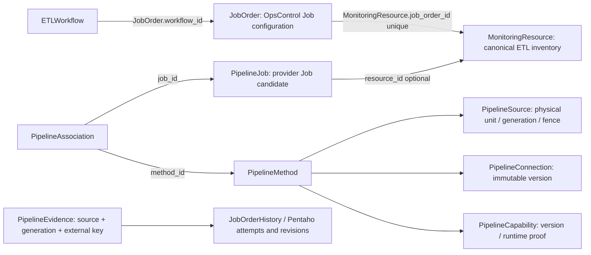

# OC-ETL-005 — Native Job binding contract

> OC-ETL-006 follow-on: D01–D06 product-owner authorization is recorded in the [decision register](OC_ETL_005_DECISION_REGISTER.md). The original current/proposed inventory below describes the immutable OC-ETL-005 baseline. [Current implemented subset and blockers](../../verification/oc-etl-006/APPROVAL_AND_SCOPE.md), [migration contract](../../verification/oc-etl-006/MIGRATION_AND_RECOVERY.md), and [served readiness transitions](../../verification/oc-etl-006/READINESS_TRANSITIONS.md) supersede implementation availability only. No provider or release certification is inferred.

Status: **CURRENT CONTRACT INVENTORY + PROPOSED EXTENSION / PENDING ACCOUNTABLE APPROVAL**. Date: 2026-11-06 UTC. Immutable inspected product baseline: `9c021bbb94de3017bdc9f41b6a774d7b378ae9a7`, branch `dev/post-pr78-architecture-closure-20261105`, draft PR80.

This document distinguishes implemented behavior from approval-dependent design. It creates no endpoint, permission, migration, provider certification or activation authority. [Decisions D01–D10](OC_ETL_005_DECISION_REGISTER.md) are not signed off. [Verification](../../verification/oc-etl-005/REPORT.md) identifies actual executions separately from proposed acceptance cases.

## 1. Authority and interpretation

- [ARCH-ETL-001 v1.6](../ARCH_ETL_001_V16.md) §§2–6, 8–11: native identity, canonical execution/attempt reuse, customer-scoped ownership, read-only methods, independently verified capabilities, immutable evidence/revisions, fenced generations, bounded recovery and retention. Its §15 records the owner's 2026-10-16 consolidated-baseline approval. That approval does not approve this new binding schema.
- [Unified approved scope register](../UNIFIED_JOURNEY_ETL_IMPLEMENTATION_REGISTER_20261105.md) and [ETL implementation matrix](../unified-implementation-baseline/ETL_ARCHITECTURE_IMPLEMENTATION_MATRIX.md): Workflow-first expectations, Job runtime expectations and monitoring-only boundaries. Exact v1.7 event/override definitions and 30 numbered journey definitions remain unavailable; no substitute is invented.
- [OC-ETL-004 gaps](../../verification/oc-etl-004/2026-11-06/OPEN_GAPS.md) G3 correctly identifies no WorkflowJob native-binding write field. Inspection additionally finds the existing indirect resource bridge below. This refines that gap; it does not overwrite the original evidence or claim full binding is implemented.

Approved invariants are normative now. New command/state/storage/cardinality choices below are **proposed** until the listed authority approves them. No display name, timestamp coincidence, log text or PID alone establishes native identity. No provider execution-control privilege is introduced.

## 2. Implemented object graph and ownership

Arrows indicate FK/reference direction, not permission or external execution. Resolve actual FK values; equality of Resource and Job UUIDs in some legacy fixtures is not a universal contract.

| Object | Current durable key/constraint | Authority and limits |
|---|---|---|
| Workflow | UUID; unique organization/environment/name | `models/entities.py:ETLWorkflow`; name uniqueness is an editor constraint, not native identity |
| OpsControl Job | JobOrder UUID, optional legacy workflow_id; immutable authenticated workflow/organization relationship | `api/etl.py`, `security/scope.py`; legacy unassigned Jobs stay unassigned; name/VM uniqueness is not provider identity |
| Canonical inventory | MonitoringResource UUID; unique job_order_id; ETL domain requires Job reference | `unified/models.py`; Resource Management owns inventory/configuration, operational views consume evidence |
| Native candidate | PipelineJob UUID; unique (integration_id,native_id); optional resource_id | `data_pipelines/models.py`; integration scopes customer/platform/environment. Manual native_id is an operator claim until independently verified; nonempty text is not proof |
| Physical source | unique (organization_id,canonical_key); canonical_key hashes method type and normalized physical identity | `service.canonical`; API/database identity contains platform/endpoint/account/physical_scope; file identity contains host UUID/path/OS. No environment column exists on PipelineSource: do not claim one |
| Method/version | PipelineMethod UUID/revision + source ID/generation + connection UUID/version/checksum + capability UUID/proof + reader hashes | `service.reader_definition`, `reader_contract`, `reader_equivalence`; same-customer physical sources may be shared only within existing conservative equivalence/authorization rules. Poll cadence exclusion is not permission to ignore other differences |
| Source association | unique (method_id,job_id,generation), confirmed_by actor | PipelineAssociation.job_id references PipelineJob, not JobOrder; generation must match source for current routing |
| Evidence / execution | unique source/generation/external_key; canonical History and PentahoAttempt identity/revision constraints | `service.accept`, `unified/pentaho_models.py`, `pentaho_execution.py`; no second execution engine/table hierarchy is authorized |

Tenant consistency must cover Workflow, JobOrder, Resource, native Job, integration, method, connection, capability, source and evidence. Every binding must also agree on the Workflow/Job/Resource/integration environment. A source's shared physical identity does not grant cross-environment or cross-customer binding authority. Existing same-organization composite FKs are not proof that every cross-model environment relationship is a DB constraint.

### Execution and evidence relationship

One Workflow owns many configured Jobs; each new Job has one immutable parent, while legacy Jobs may remain unassigned. Each Job can have many canonical execution projections over time. The approved logical execution, attempt, step, schedule occurrence and recovery relationship are distinct; provider/scheduler evidence must establish grouping. Current JobOrderHistory/PentahoAttempt/revision models are reused, but complete Workflow occurrence membership is not implemented or inferred here.

The current pipeline accepts evidence under `(source,generation,external_key)`, resolves confirmed current-generation method/native-Job associations, and routes to the canonical Resource/Job projection. Unknown identity yields quarantine; ambiguous distinct target Resources are not fanned out as confirmed observations. Several methods observing one verified target do not authorize duplicate logical executions. A manually recovered run remains separate from the original failed execution unless verified scheduler/native authority establishes an attempt relationship. Epoch/context, not display name or arrival time, determines whether recycled execution IDs refer to the same run. Old-generation live tickets remain rejected even when their timestamps look plausible.

## 3. Current supported staged bridge — no new write authority

`POST /api/v1/data-pipelines/integrations/{id}/jobs` accepts the existing JobInput fields `native_id`, `name`, optional `resource_id` plus mutation idempotency/revision metadata. `api.register_job` checks resource visibility, ETL domain, customer/environment, inherited VM where declared, and existing configured native/integration identity conflicts.

For a Workflow child's canonical Resource without pipeline_integration_id, it creates **LEGACY_PENDING / quarantined / not selected**. It does not set Workflow activation, rewrite the parent, prove identity, collect data or disable a separately approved legacy collector. Exactly repeated idempotency returns the original candidate; another operation cannot insert the same integration/native ID. A known mismatched Resource native ID is rejected. Do not generalize this to a DB-enforced one-native-target-per-Resource constraint: resource_id is not unique on PipelineJob and staging of unknown claims is not active binding validity.

Existing method association is explicit `POST .../integrations/{id}/associations` with confirmed job/method IDs. Both must belong to the integration, and the server stamps the locked source generation and current actor. Confirmation does not bypass quarantine or capability verification. `select_job` denies a quarantined candidate.

Existing reviewed legacy/source handoff uses `change-preview → independent approve → apply`, with current-source locking, revision/generation comparison, platform-admin restrictions and distinct reviewer. Legacy cursor handoff additionally requires exactly one confirmed native/cursor mapping, compatible platform/environment, an eligible legacy collector type, no concurrent local collector and no overwrite of accepted V1.6 progress. It retains Resource/Collector/JobOrder UUIDs and archives the checkpoint, then requires fresh continuity/capability validation. A source handoff is **not** a general Workflow-native-binding replacement API.

Current `DELETE .../associations/{id}` deletes the association row and records operation/audit IDs; source/evidence/history rows remain. Current events are not a complete append-only before/after binding-version registry. This limitation is verified and remains D06 BLOCKED for the stronger historical contract. Do not claim full historical binding provenance merely because receipt rows survive.

## 4. Proposed canonical native identity and cardinality — D01/D02

Recommended conceptual key (not provider field names):

`(customer UUID, platform, environment, verified native authority/namespace, native object kind, immutable provider object key)`.

The provider adapter must document exactly which authenticated fields establish authority/object key, including repository/server/start epoch where needed. Its normalization schema/version is part of provenance. Preserve original claims and immutable verified aliases; do not globally lowercase opaque native IDs or equate paths/names across providers. Native execution identity additionally requires verified invocation/run/attempt authority; Carte run IDs require server/restart epoch and process identity requires host/start epoch. Recycled IDs must not join unrelated histories.

Recommendation, pending owner approval:

1. One current canonical native target per OpsControl Job configuration; one current owning Job configuration per qualified native target/customer/environment. Multiple independently versioned collection methods may observe that same target. No implicit fanout into several Workflows. All method references in one binding belong to its native Job's owning integration under the current API contract. Shared physical sources across integrations do not approve native-Job aliases or multiple Workflow owners; duplicate qualified-target claims across integrations remain conflicted pending an explicit alias decision.
2. A display-name change does not change identity. Same-target method/reader replacement creates a new binding version without rewriting execution identity.
3. Different native authority/object identity requires new Job/Resource/native identities. A separately approved supersedes relationship may connect old/new configurations for presentation; it must not merge their executions. Current Job.workflow_id immutability remains; no cross-Workflow reparenting through a binding command.
4. Ambiguous claims, duplicate current owners, or missing authority proof are quarantined/blocked. No name-based backfill or automatic selection.

These recommendations require D01/D02 approval and provider-specific proof before a new VALID binding state can be served. Current PipelineJob uniqueness alone does not implement this proposed cardinality.

## 5. Proposed binding commands and transition contract — D03/D04/D06

Logical commands below are **not currently available HTTP endpoints**. Public route/schema details require review. Each command must accept only typed UUID/version references, an idempotency key, expected revisions, explicit confirmation and a reason; no arbitrary provider configuration, secret value, SQL, command body or producer-supplied verified flag.

| Command | Preconditions / locking | Committed result / failure behavior |
|---|---|---|
| StageBinding | Current actor may configure visible Workflow/Job/Resource and native integration in one customer/environment; exact parent and native identity references; missing provider proof allowed only as a staged claim | Immutable proposed tuple, STAGED; no activation, reader start, legacy shutdown or history mutation; identical retry returns same version; changed payload/key conflict refuses |
| ConfirmBinding | Independent proof references for identity/namespace; current method/connection/capability versions and source generations; all scoped ownership checks; explicit required approval | New confirmed version only. VALID is structural/identity validity, not active collection or healthy execution |
| ReplaceMethodBinding | Same native target only; impact preview includes all source consumers; expected active binding/source/method versions; authorization refreshed under existing transaction authority | Atomically close old version and add new version; fence/hold affected readers through reviewed source handoff until accepted work and checkpoint continuity are reconciled; no auto-activation |
| RetireBinding | Explicit retirement/retention confirmation, hold checks and inventory of accepted/in-flight work | End current validity; prevent future eligible routing while preserving immutable tuples/evidence and approved legacy compatibility; no provider job stop or deletion |
| Reassign / identity-changing replace | Current parent/tenant immutability or authority differs | DENY under current contract. Provision distinct configuration/identity with separately approved migration/supersession; never silently retarget old history |

Use deterministic row/source-lock ordering and DB uniqueness constraints for concurrent stage/confirm/replace operations; do not add a global runtime serialization lock. Existing authority/revocation locks remain mandatory. Any shared-source fence affects other consumers: require their visibility/authority and reviewed impact rather than allowing a single Job editor to disrupt unrelated monitoring.

The initial safest replacement design uses the reviewed source generation/hold protocol. A finer per-binding cutover would require a binding-set version in leases, acceptance receipts and routing; that protocol is not approved or implemented. Neither option may advance checkpoints for unacknowledged work or claim zero loss against CHK-001.

All mutations commit binding-version metadata, immutable relationship snapshot, operation result and domain audit atomically. On any authorization, duplicate, version, hold, proof or persistence failure, roll back the entire graph mutation; record security denial separately without a false domain SUCCESS. Actor/reviewer and current authorization must be checked again at apply/commit, not only in the browser or preview. Current permission keys remain unchanged until D04 decides any narrower configuration/approval keys; no execution-control permission is proposed.

## 6. Historical evidence, source transitions and legacy behavior

Retain immutable binding version tuples with validity intervals and causal operation IDs; raw evidence keeps its original source/generation/native claim/hash/receipt, and canonical histories/attempts retain original resource and execution keys. Do not rewrite earlier executions to follow a new current pointer. Late evidence must be evaluated under its actual provenance and approved reconciliation rules; event-time matching alone cannot bypass stale owner/generation checks. Already accepted historical evidence may be reconciled through approved bounded recovery; an old live lease remains rejected.

Source handoff currently changes generation/fence, resets observation/owner state, invalidates method validation, archives checkpoints and creates a continuity hold. Old-generation association rows remain stale until explicit confirmation; no silent rebasing to the new generation. Connections/methods/proofs and capability attestations must be revalidated. Identity or physical-reader changes require scoped impact, continuity and separate approval.

Legacy unassigned JobOrders stay unassigned. Resource/Job/Collector IDs, old runtime fields, audit, legal holds and recovery metadata are preserved. A staged candidate never infers a Workflow from a name or migrates a legacy Job into a different parent. Existing legacy activation and Pipeline V1.6 activation remain separate authorities; neither makes a Workflow active merely because a Resource is linked.

Approved retention defaults remain raw evidence30d and audit≥365d subject to policy/holds, not automatic deletion instructions. Holds must protect binding provenance as well as receipts in the future design. Existing association deletion cannot be presented as proving those future guarantees.

## 7. Storage and migration options — D06 (no migration implemented)

| Option | Benefit | Risk / decision |
|---|---|---|
| A: existing pointers/associations plus operation snapshots only | Smallest storage footprint; staged path already works | Current mutable/deleted association lifetime and IDs-only audit do not enforce complete temporal uniqueness/provenance; JSON snapshots alone require additional invariants. Not sufficient to claim the new contract today |
| B: additive append-only binding versions referencing existing identities, with versioned method/proof snapshots | Explicit cardinality, temporal ownership, audited cutover, immutable provenance without a duplicate run engine | Recommended **after approval**; needs new migration, legacy reconciliation and changes to routing/retirement semantics. Exact columns/constraints are not approved here |
| C: replace JobOrder/PipelineJob or directly reparent existing Jobs | Superficially fewer joins | Reject: breaks canonical history, legacy identity and immutable Workflow ownership; duplicates the execution engine or destroys attribution |

For B, review same-organization composite FKs, explicit environment consistency, one-active-owner uniqueness, method/source generation snapshots, RESTRICT relationships and retirement semantics. Source lacks environment: do not invent a nonexistent composite source/environment FK. If binding versions reference associations, current physical DELETE behavior needs a reviewed compatibility/retirement design rather than CASCADE. Forward-additive migration only; no edits to applied migrations, destructive backfill, implicit native identity inference or forced rollback. Extend populated-downgrade protection for new tables and prove fresh/populated upgrades, backup/restore hashes, concurrent writers and old-reader compatibility before use. Untested old-application rollback is not asserted reversible.

## 8. Security review and acceptance

Technical source review: Codex, this study, baseline above. **Accountable architecture/security/database approval is pending**, not fabricated by this review. Threats: forged native IDs, cross-tenant/environment references, stale generation/reader proof, role revocation races, duplicate owners, in-flight retargeting, association-history erasure, secret leakage and false activation. Existing staged/API checks mitigate some paths; the proposed temporal/cardinality/aggregate-Workflow guarantees remain blocked.

Actual current-path test: `backend/tests/test_etl_native_binding_contract.py`; see verification report for executed counts, raw HTTP statuses, generation/historical comparisons and cleanup. Planned acceptance before implementing the extension:

| Case | Required invariant | Current qualification |
|---|---|---|
| NB-01 | Typed resource→Job→Workflow chain, canonical native identity, same tenant/environment; display-name edits do not rebind | Existing staged chain tested; new confirmed/versioned binding BLOCKED D01–D03 |
| NB-02 | Idempotent retry; duplicate/conflict concurrent writers yield one owner and no partial operation | Current duplicate/conflict rollback tested; concurrent temporal-owner registry BLOCKED D02/D06 |
| NB-03 | Cross-customer, forged source, cross-environment, revoked role and worker-as-human denied | Current scope/revocation negatives tested; future approval roles D04 pending |
| NB-04 | Same-target reader replacement fences old work, preserves receipts/cursor, invalidates stale proof | Existing reviewed source handoff/generation tested; new atomic binding replacement NOT IMPLEMENTED |
| NB-05 | Native identity-changing/reparent operations deny; supersession never rewrites history | Existing immutable parents retained; future supersession semantics D02 pending |
| NB-06 | Retirement retains full tuple, audit, holds and execution/evidence; failed commit leaves old version authoritative | Receipt preservation tested; deleted association row is a documented provenance gap, not a full PASS |
| NB-07 | No activation from staged/unverified/absent/stale sources, missing proof or unknown Workflow contract | Current denials tested; genuine verified active positive BLOCKED external evidence/D03 |
| NB-08 | Freshness, health and attempts remain separate; stale-generation late records never bypass ticket checks | Existing guards retained; provider-epoch/late-catalog certification NOT TESTED |

No production/customer/UAT targets, provider execution or release promotion is authorized. CHK-001 FAIL · CHK-002 BLOCKED · SECURITY BLOCKED · RELEASE NO-GO.
