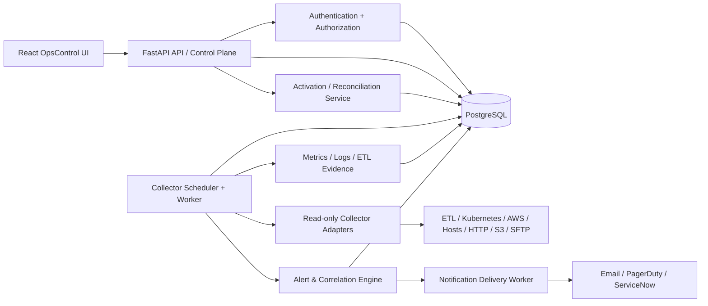

# 01 — System Architecture (Proposed)

## Architectural objectives
One operator console; authoritative organization-scoped data; read-only monitoring integrations; safe, replayable evidence ingestion; independently scheduled collectors; observable and idempotent alerts; simple local development. The product is a **modular monolith plus background workers**, not prematurely split microservices.

## Resource discovery and private-network collection extension
The detailed [Resource Discovery and Infrastructure Monitoring specification](14-RESOURCE-DISCOVERY-INFRASTRUCTURE-MONITORING.md) extends this modular architecture with a Discovery Manager, provider registry, candidate review/import, canonical resource inventory, runner pools and private-network remote agents. Discovery is **not** automatic monitoring activation. Local/private agents establish an outbound authenticated channel and do not require exposing private applications publicly. See also the [Internal Application HTTP/Synthetic design](13-INTERNAL-APPLICATION-UI-MONITORING.md).

## Logical components

## Component boundaries
| Component | Owns | Explicitly does not own |
|---|---|---|
| React | Presentation, navigation, input validation, polling and visual evidence | Authentication policy, tenant scoping, scheduling, state of truth |
| FastAPI | Contract validation, identities and permissions, configuration CRUD, activation requests and queries | Long-running polling or privileged arbitrary commands |
| PostgreSQL | Organization-aware state, versioned configuration, source evidence, alert/notification history | External secrets, application logic |
| Activation service | Resolve/validate templates and idempotently provision effective config | Remote source installation or unapproved remediation |
| Collector runtime | Due-work claiming, transport adapters, bounded retries, run state, observations | Editing ETL jobs or modifying production workloads |
| Evidence/alert workers | Metric/log ingestion, rule evaluation, correlation, state transitions | Unsupported source guesses or confirmed RCA from weak signals |
| Notification worker | Delivery retries, provider-specific deduplication, audit | Rollback of source evidence or source-system mutations |

## Core data flows
1. **Onboarding:** Authenticated actor -> authorized Organization -> Data Source -> template attachment -> activation preview -> validated desired revision -> reconciled collector/metric/log/alert records -> worker claim -> sample/event -> dashboard.
2. **Investigation:** Source execution -> read-only normalized ETL facts -> historical record -> scoped evidence correlation -> alert -> notification -> operator review.
3. **Security:** Identity -> allowed organizations/roles -> policy decision -> SQL scope. The UI's selected organizations are preferences only, never authorization.

## Sprint 3 ETL evidence path

The [Pentaho ETL implementation](../../PENTAHO_ETL_MONITORING.md) uses the existing scheduler, scoped Data Source/Collector and CollectorRun transaction. A platform-approved local collector reads a pinned, authenticated Carte inventory and exact-job status details. The worker validates Job Order/source ownership before credential resolution or network access. Failed polls preserve source facts and report collector ERROR.

The ETL ingestion service deduplicates JobOrderHistory by Job Order/provider ID, preserves source timestamps and terminal facts, stores bounded redacted opt-in evidence, and persists job-entry results. Daily timezone/window/grace evaluation creates an explicit OpsControl No Run diagnosis only after complete successful inventory evidence; unknown source timing suppresses absence inference. Runtime thresholds are captured per execution. Condition changes append stable Job Order/condition references to AlertIncidentEvent; external ETL delivery and rule-catalog-based ETL activation are follow-up work.

JobOrder has an explicit tenant-checked host Data Source association, so failure correlation reads actual same-organization host samples and native infrastructure alerts in its time window. Correlation is supporting evidence, not RCA. The read-only execution/evidence APIs back current ETL rows, logs, timelines and clickable retained history. Investigation reads do not create state, and authorized transitions/notes record the authenticated actor. Successful recovery never rewrites a failed history or resolves an investigation automatically.

The controlled fixture uses actual authenticated HTTPS and a disposable real Linux process. Its evidence origin remains distinct from genuine Carte compatibility/retention acceptance. See the [Sprint 1–3 reassessment](../../SPRINT_REASSESSMENT.md) for the acceptance gates and remaining UI/release work.

## Sprint 4 operational evidence path

The [operational dashboards](../../OPERATIONAL_DASHBOARDS.md) expose scoped `/api/v1/operations` service, incident, report and history queries. HTTP views read sanitized CollectorRun fields and native AlertState records; infrastructure keeps its existing evidence API. Reports aggregate persisted observations within bounded windows and distinguish sampled probe success, runtime SLA, job outcomes and excluded/unknown evidence. Read endpoints never create incidents or investigations.

`OperationalIncident` owns one source alert episode, while `IncidentActivity` appends source and authenticated operator events. Metric and ETL workers create/recover incidents in their existing evidence transaction. Source recovery and operator closure are separate states. Metric rules are locked during evaluation and reject older observations; repeat polls preserve identity, while relapse opens a distinct episode. Migration 0021 backfills historical episodes and recovery facts and installs a database activity mutation guard.

Organization read scope, same-tenant foreign keys, immutable ownership and organization-specific operator permission cover the new tables and routes. A viewer membership cannot gain write rights because the user is an operator in another organization. React scope changes cancel/discard obsolete requests and reset open evidence. API/incident drawers connect source runs, alerts, historical ETL correlation and investigation. Unified history and JSON reports provide reusable read-only operational evidence.

The Sprint 4 virtual lab uses disposable PostgreSQL, real certificate-verified synthetic HTTPS/Carte responses, real Linux host observations and actual password-authenticated Playwright journeys across every navigation tab. Genuine providers, remote CI, independent review, release hardening and deployment acceptance remain separate.

## Deployment topology
**Dev and CI:** React/Vite + one FastAPI app + PostgreSQL 17 + separately launched worker. CI uses ephemeral database and synthetic sources; no live customer integration. **Later deployment:** package existing modules into separate API/worker containers (same codebase) with managed PostgreSQL and external secrets. EKS/Helm/GitOps/Terraform follows functional acceptance rather than drives design.

## Reliability policies
- Workers must use DB-backed claiming/lease or a single-worker guarantee, plus idempotency keys and heartbeat/timeout.
- Failed transport must be `NO_RESPONSE` or collector `ERROR`, not automatically an ETL `FAILED`.
- DB commit of an observation must not depend on external notification success.
- UI distinguishes `no data`, `loading`, `stale`, `collector unavailable`, and actual business failure.
- Collection intervals and the UI's 5-second refresh are separate concerns; bound API query volume.

## Implemented HTTP and infrastructure reference flows (Sprint 2)

HTTP activation pins immutable Metric/Log/Alert Rule versions and binds an approved organization-scoped remote worker. Actual TLS health evidence reaches native samples/logs and alert OPEN → RESOLVED transitions. [HTTP golden path](../../HTTP_GOLDEN_PATH.md) contains the local browser/database evidence.

Infrastructure activation uses the same versioned desired configuration and stable materialized identities. A platform administrator approves discovery/import and collection using local deployed workload identity; tenant administrators cannot enumerate provider inventory through a shared identity. AWS validates its expected account; Kubernetes uses only its in-cluster service account and approved Node names; host adapters inspect the machine running the worker. Discovery imports inactive inventory keyed by `(organization_id, discovery_external_id)`, so renaming does not create a second resource.

Each local run persists `CollectorRun`, a sanitized `InfrastructureEvidence` observation carrying organization/source/collector/run ownership, available `MetricSample` rows and native alert evaluations. VM Health and Overview query scoped infrastructure endpoints. Missing or stale observations remain UNKNOWN; disabled collectors remain distinct. The HTTP remote agent cannot execute infrastructure tasks.

[Infrastructure acceptance](../../INFRASTRUCTURE_MONITORING.md) records actual Linux observations and controlled AWS, authenticated TLS Kubernetes and Windows lifecycle evidence. Genuine AWS/cluster/Windows gates remain separate. The local scheduler requires a single-worker guarantee; multi-host routing and leases are not delivered by this slice. Deploy the host worker on its intended host; it cannot centrally poll arbitrary remote VMs. ETL/Pentaho genuine acceptance and wider UI/release work remain follow-ups.

## Open design choices
OIDC identity provider, expected tenant scale, metrics cardinality, SLO targets, retention and data residency, first Pentaho read API, whether notification providers will be enabled in the first operational release.
