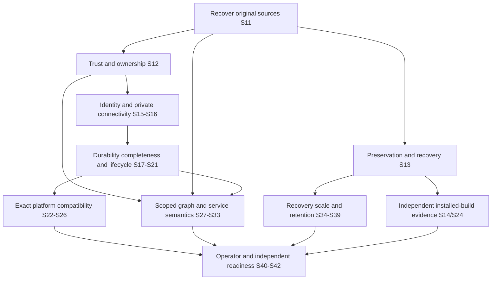

# Dependencies, source conflicts and decisions

## Authority and source blockers

| Decision | Evidence / problem | Required decision and owner input | Blocking scope | Proposed checkpoint |
|---|---|---|---|---|
| DEC-01 Original improvement authority | No approved definitions recovered for 62 entries; eight exact titles only from current owner instruction | Owner supplies original register, revision and approval record; reconcile exact wording | Definitive IMP implementation status, overlap and acceptance | S11 |
| DEC-02 Original roadmap | Historical roadmaps exist; detailed Sprint 11–42 source not recovered | Owner supplies original or explicitly reviews conditional replacement proposal | Claims that original detailed sequencing was preserved | S11 |
| DEC-03 Formal architecture sign-off | D5 requires reconciliation sign-off; this package has source unknowns | Owner and independent reviewers accept residual unknowns or require recovery first | Formal architectural/production acceptance | S11 / S41 |
| DEC-04 Deployment and independent provider boundary | Current model is one provider/many customers | Choose single-enterprise or provider-operated deployment; independent providers need explicit separate review | Shared infrastructure, login/service ownership and trust | S12 |
| DEC-05 Runtime environment | Real installations/credentials/witness not authorized or supplied | Approve exact builds/read-only observation environment and independent evidence process | Genuine RT acceptance and platform certification | S14 / S24 |
| DEC-06 PKI and network | Token lifecycle and configured TLS are not issuer/network operations | Name issuer, rotation/revocation owner, approved trust zones and private routes | Credential/connectivity adoption | S15 / S16 |
| DEC-07 Recovery and data policy | Backup tools exist; target RTO/RPO/residency/retention/attestation unresolved | Approve recovery objectives, isolated site, retention exceptions, archive ownership and privacy policy | Production durability and legal compliance | S13 / S34 / S39 |
| DEC-08 Service/SLO/graph authority | Titles and existing mechanisms do not supply complete requirements | Recover graph/SLO definitions and approve service ownership, formulas, freshness and historical semantics | S27–S33 functional scope | S11 then S27–S33 |
| DEC-09 Capacity and client ownership | Controlled local results only; third-party migrations not certified | Approve representative datasets, measured capacity goals and external-client owner list | Fleet readiness and external rollout | S35 / S36 |
| DEC-10 Independent go/no-go | Self-review and prior controlled gates cannot certify production | Independent security/runtime/operator approval and explicit deployment authorization | Production adoption | S41 / S42 |

## Confirmed documentation conflicts; no silent architecture change

1. Historical [docs/OPERATIONAL_ARCHITECTURE.md](../../../OPERATIONAL_ARCHITECTURE.md) and [docs/IMPLEMENTATION_ROADMAP.md](../../../IMPLEMENTATION_ROADMAP.md) contain retired-native-incident statements. Later approved [docs/architecture/ARCH_001.md](../../../architecture/ARCH_001.md) V1.5 extensions and [ETL authority](../../../architecture/ARCH_ETL_001_V16.md) require native incidents. Current native incident code and Sprint 06–09 evidence implement the later requirement. External ITSM remains separate/retired; no new ITSM requirement is inferred.
2. [docs/SECURITY_RELEASE_CHECKLIST.md](../../../SECURITY_RELEASE_CHECKLIST.md) states notification IO holds a transaction. Current [backend/app/worker/notifications.py](../../../../backend/app/worker/notifications.py) detaches the claim before provider IO. Treat the old checklist as a historical unresolved item superseded for that specific behavior; real provider/crash delivery acceptance remains open. Baseline documents are not rewritten here.
3. [docs/sdlc/phase2/07-ADRS.md](../../../sdlc/phase2/07-ADRS.md) explicitly says PROPOSED; those ADRs cannot silently become approved ARCH-001 decisions. The consolidated ETL architecture has separate recorded owner approval; it is not a verbatim historical transcript.
4. Earlier milestone sections say frontend/RBAC work is pending; later [Sprint 08](../sprint08/REPORT.md)/[Sprint 09](../sprint09/REPORT.md) verify controlled implementation. Timestamped evidence resolves the apparent status conflict, not by deleting history.

No executable architecture conflict is confirmed by this representative review. Open questions and coverage limitations are not treated as proof of compliance. Canonical identities, collection fences, customer isolation, legal holds, independent decisions and monitoring-only boundaries remain protected.
