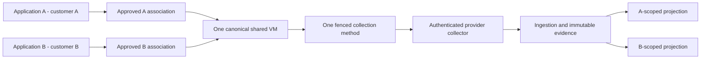

# One shared-VM customer authorization scenario

## Approved target and current representability

Target: Customer A owns Application A; Customer B owns Application B; both depend on **one canonical infrastructure VM**. A provider collector observes that VM once with independent collection-method identities. Provider operator AB may view approved A and B projections; employee A may view only A; employee none views neither. The shared VM's physical/canonical identity is stable. Association and permission checks, not customer-name inference, determine every customer projection. An A grant never exposes B-only application telemetry or enables shared VM mutation.

**Current implementation does not represent this complete target.** [backend/app/unified/models.py](../../../../backend/app/unified/models.py) `MonitoringResource.organization_id` is singular and `vm_id` unique. The same module's `ResourceDependency` has same-organization composite FKs for both ends. [backend/app/unified/api.py](../../../../backend/app/unified/api.py) `add_dependency` rejects cross-customer/environment edges and `resource` requires the owning organization's permission. [backend/app/models/entities.py](../../../../backend/app/models/entities.py) `VM.organization_id` is singular; [backend/app/unified/compatibility.py](../../../../backend/app/unified/compatibility.py) already registers the one canonical VM binding for legacy VM creation. Creating duplicate customer VMs or resources to make both views appear to work would violate GOV-04. No migration or workaround was introduced in Sprint 12.

## Identity and authorization map

| Entity / actor | Required identity and scope | Current observation | Target requirement |
|---|---|---|---|
| Customer A/B | Two immutable Organization IDs, never Department IDs | Existing paired role/customer grants and explicit selection | Authorization remains independent of grouping/labels. |
| Application A/B | Separate application IDs and owner associations | Existing `Application.vm_id` resolves customer through one VM owner | Each customer-owned application needs a safe association to shared physical VM without inheriting the other customer's data. |
| Shared infrastructure VM | One native and canonical VM/resource identity | Current VM and monitoring resource each have one organization; second binding denied | Controlled multi-customer visibility association with owner, revision, provenance, relationship history and explicit per-view permission. |
| Collector and methods | Provider-operated collector identity, scoped credential, method IDs, source generation/fence | Current collector/data source/agent bindings follow one customer; forged method IDs rejected in controlled fixture | One collection owner per canonical method unit; immutable source proof and authorized attribution to customer views. |
| Operator AB | Direct/inherited role permissions and explicit A+B grant | Existing resolver permits only selected and authorized customer IDs | May see allowed A/B records and shared projection; view permission alone never grants update. |
| Employee A | A-only grant/selection | A-only fixture sees A resource/application and 404 for B resource | Sees approved shared VM subset but no B app, B-only evidence or B graph neighbor. |
| Employee none | No customer grant | Empty scoped inventory in fixture | Learns no A/B resource, incident or analytics identifier. |
| Dependency/incident | Versioned, scoped relationship and incident IDs | Current same-customer FK/route checks; seven-state incidents are customer scoped | A/B projections reference one canonical VM without exposing the other's private topology or root evidence. |

## Trust and provenance flow

This is the **approved target architecture**, not a diagram of working cross-customer projection code. Current code lacks the A/B association and customer-safe shared projection needed between evidence and views. Raw telemetry, source ownership and the native VM identity must not be duplicated to simulate it.

## Controlled result and gating decision

[Focused fixture](../../../../backend/tests/test_sprint12_shared_trust.py) checks A+B, A-only and none access using paired grants, direct detail lookup, forged selection, application isolation, denied cross-customer dependency insert, denied second VM binding, and method-ID mismatch. Existing Sprint 08 RBAC and pipeline fence/FK tests are also run; [actual results](TEST_MATRIX.md) distinguish observed passes from unimplemented target behavior. The positive requirement—*both customer views reference the same canonical VM under approved associations*—is **BLOCKED BY CURRENT MODEL**. Derived graph/incident visibility on such a shared VM is correspondingly **UNVERIFIED**, though existing single-customer incident and scope controls remain in place.

A future separately authorized, additive design must specify association identity/ownership, visible field subsets, tenant-safe incident/analytics projections, ingestion attribution, revision/audit, transition of populated records, legal-hold preservation and backward-compatible API behavior. This is a P0-03 dependency; neither canonical identity nor customer scope can be weakened as a shortcut.
