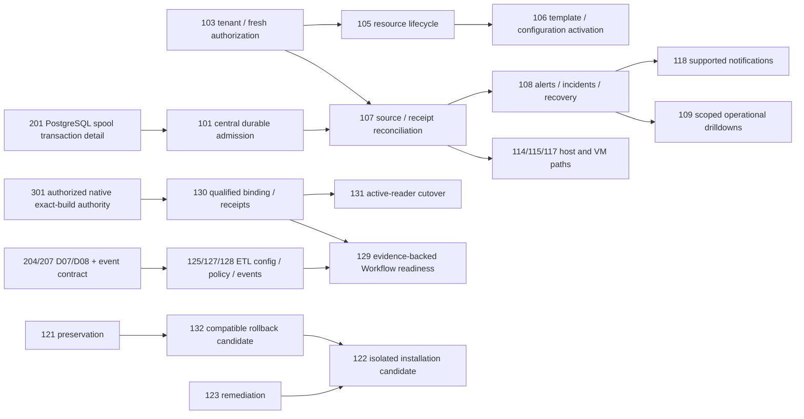

# Dependency graph and critical paths

[Exact edges](DEPENDENCIES.json), [topological levels](DEPENDENCY_LEVELS.json); all55 items have stable IDs, all dependencies resolve, no cycle detected. Complexity/levels are relative planning aids, not duration estimates.

## Critical paths and scope boundaries

- Data reliability: **201 →101 →107 →108 →118/109**. Preserve centralized PostgreSQL durable-spool design. Existing batch receipts and atomic checkpoint commits are adjacent foundations, not proof of the missing spool/recovery guarantee. Collector pre-admission losses remain a separate source-completeness boundary; do not close CHK001 using only downstream DB counts.
- Native ETL: **301 →130 →131**, and **204/207 →125/127/128 →129**. Configuration CRUD and negative tests do not need genuine provider authority; successful qualification/cutover/aggregate positive readiness do. Never require operational HEALTHY before saving configuration or use saved config to invent health.
- Safe runtime candidate: **121 +501 →132**, then **132 +123 +503 →122**; independent303/304/305/306 and owner approval remain separate release/deployment prerequisites.
- Global performance135 can be investigated after tenant-safe fixture103 and in parallel with spool work; it must not wait for a provider or whole release certification. It covers all modules, not VM Health alone.

## Avoid unnecessary sequencing and circularity

No dependency on formal UAT401/402 blocks safe approved coding or automated tests. No all-product dependency on the30 unrecovered numbered journeys; use recovered canonical IDs while leaving exact numbered mapping blank. No prerequisite to merge PR80 automatically;501 reviews candidate provenance and integration remains separately controlled. No source health→activation→receipt cycle is resolved by fake healthy data. Frontend configuration must consume backend authority rather than duplicate it. Security123/authorization103/preservation121 run throughout the plan, not only at the end. D07/D08, licensing and retired-channel decisions gate only affected behavior.

No future implementation is authorized by this graph. Current gate state stays **CHK-001 FAIL · CHK-002 BLOCKED · SECURITY BLOCKED · RELEASE NO-GO.**

