# Development dependency graph

Execution references from the approved program; not new canonical requirements or authorization to start a later sprint. All20items remain NOT STARTED.

```mermaid
flowchart TD
  COMP_S01_01["COMP-S01-01: Resource Management"]
  COMP_S01_02["COMP-S01-02: Templates"]
  COMP_S01_01 --> COMP_S01_02
  COMP_S02_01["COMP-S02-01: Collectors"]
  COMP_S01_02 --> COMP_S02_01
  COMP_S02_02["COMP-S02-02: Collector lifecycle"]
  COMP_S02_01 --> COMP_S02_02
  COMP_S03_01["COMP-S03-01: Central PostgreSQL spool"]
  COMP_S02_02 --> COMP_S03_01
  COMP_S03_02["COMP-S03-02: Spool implementation/recovery"]
  COMP_S03_01 --> COMP_S03_02
  COMP_S04_01["COMP-S04-01: Host metrics/inventory"]
  COMP_S03_02 --> COMP_S04_01
  COMP_S04_02["COMP-S04-02: Selected processes/services"]
  COMP_S04_01 --> COMP_S04_02
  COMP_S05_01["COMP-S05-01: Historical monitoring"]
  COMP_S04_02 --> COMP_S05_01
  COMP_S05_02["COMP-S05-02: Retention/freshness"]
  COMP_S05_01 --> COMP_S05_02
  COMP_S06_01["COMP-S06-01: API monitoring"]
  COMP_S05_02 --> COMP_S06_01
  COMP_S06_02["COMP-S06-02: Read-only Pentaho"]
  COMP_S06_01 --> COMP_S06_02
  COMP_S07_01["COMP-S07-01: Background alerts/recovery"]
  COMP_S06_02 --> COMP_S07_01
  COMP_S07_02["COMP-S07-02: Email/PagerDuty"]
  COMP_S07_01 --> COMP_S07_02
  COMP_S08_01["COMP-S08-01: Operational/frontend"]
  COMP_S07_02 --> COMP_S08_01
  COMP_S08_02["COMP-S08-02: Excluded-code reconciliation"]
  COMP_S08_01 --> COMP_S08_02
  COMP_S09_01["COMP-S09-01: Security/supply chain"]
  COMP_S08_02 --> COMP_S09_01
  COMP_S09_02["COMP-S09-02: Performance/recovery"]
  COMP_S09_01 --> COMP_S09_02
  COMP_S10_01["COMP-S10-01: Integrated development candidate"]
  COMP_S09_02 --> COMP_S10_01
  COMP_S10_02["COMP-S10-02: Final review checkpoint"]
  COMP_S10_01 --> COMP_S10_02
```

Critical path follows approved Sprint1 resource/configuration → Sprint2 collector → Sprint3 spool → Sprint4 host/process/service → Sprint5 history → Sprint6 API/Pentaho → Sprint7 alerts/Email/PD → Sprint8 frontend/scope cleanup → Sprint9 hardening → Sprint10 integrated owner review. Each sprint needs review before advancement. Independent source/security/provider prerequisites can block a specific task; a label or related test does not bypass that dependency.

CHK-001 FAIL · CHK-002 BLOCKED · SECURITY BLOCKED · RELEASE NO-GO.
